# Connecting a Platform

OpenLinker works by connecting to your existing platforms — a **master shop** (PrestaShop, WooCommerce or Shoper) that is the source of truth for products and inventory, and one or more **marketplace** connections (Allegro) where offers are created and orders are ingested. This section walks you through the full connection flow using PrestaShop and Allegro as worked examples.

For WooCommerce-specific wizard steps, see the **[WooCommerce Setup Guide](../../libs/integrations/woocommerce/docs/setup-guide.md)**.

---

## Connections list

Open **Connections** in the sidebar (under the **Platform** group). The connections list shows every platform you've configured.

<!-- screenshot: connections list showing configured connections with status pills visible, or empty state before any connection is added -->
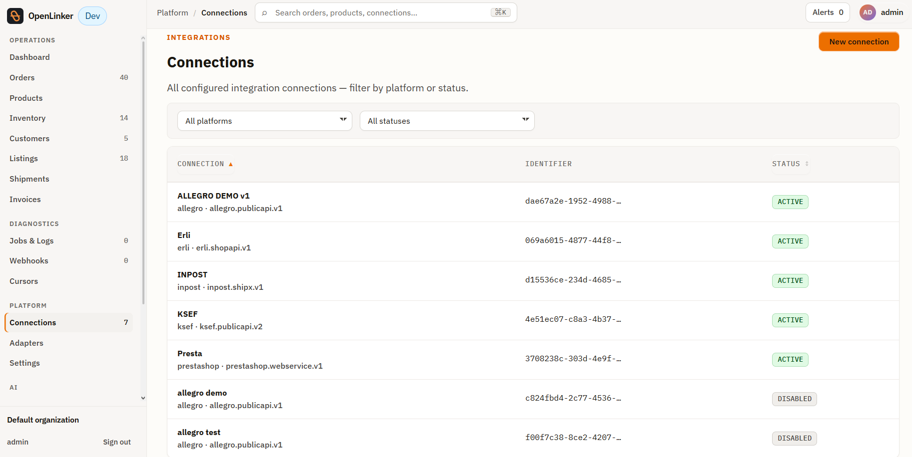

Each row shows:
- **Name** — the label you gave the connection
- **Platform** — e.g. `prestashop`, `allegro`
- **Adapter** — the specific adapter version, e.g. `prestashop.webservice.v1`
- **Status** — one of:

| Status | Meaning |
|---|---|
| **active** | Connected and all capabilities resolve correctly |
| **error** | Last connection test or sync attempt failed — check the connection detail for the error |
| **needs_reauth** | OAuth token has expired or been revoked; click the connection to re-authorize |
| **disabled** | Manually disabled; no sync jobs are scheduled for this connection |

---

## Adding a new connection

Click **New connection** (or the **Add connection** button if the list is empty) to open the platform picker.

<!-- screenshot: platform picker dialog showing platform cards (PrestaShop, Allegro, DPD Polska, WooCommerce) -->
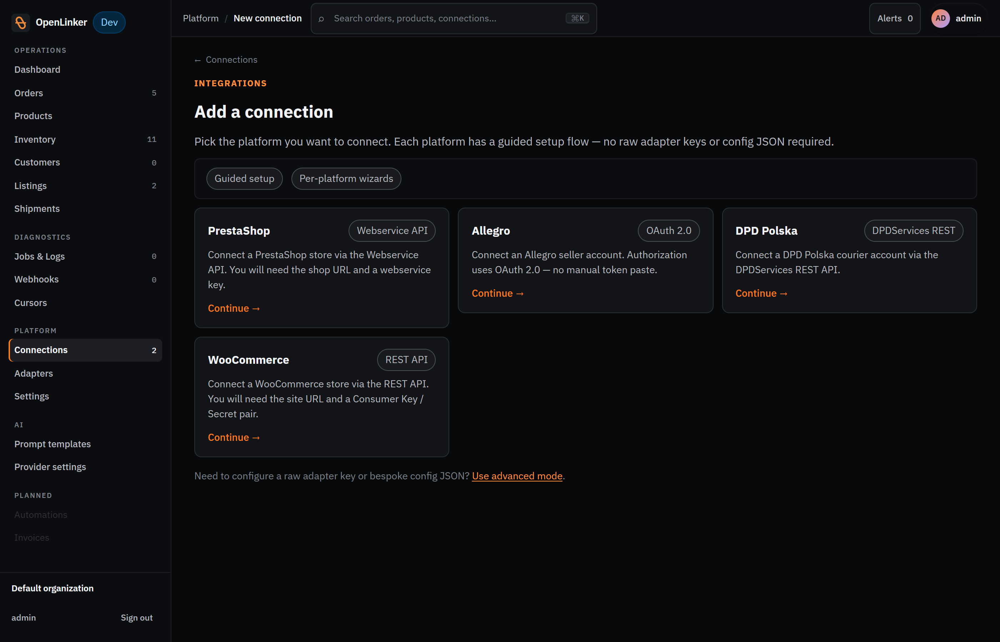

Select the platform you want to connect. The wizard adapts to the chosen platform.

---

## PrestaShop walkthrough

### Before you start — generate a webservice API key

OpenLinker calls the PrestaShop API using a webservice key. Create one in the PrestaShop admin before running the wizard:

<!-- screenshot: PrestaShop admin — Advanced Parameters → Webservice → Add new webservice key form -->
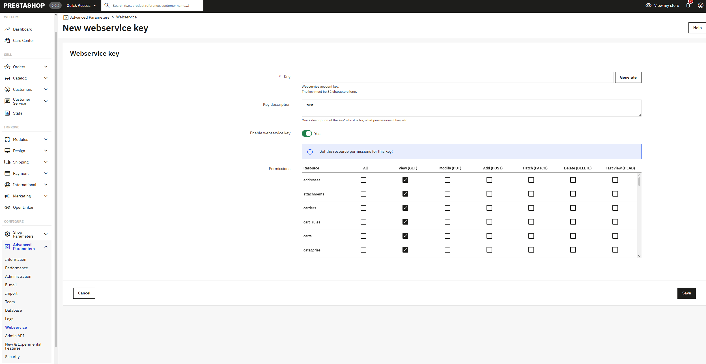

1. Open the PrestaShop admin → **Advanced Parameters → Webservice**.
2. The webservice should be enabled (the dev stack enables it automatically).
3. Click **Add new webservice key**.
4. Set a description (e.g. `OpenLinker`), tick **GET** permissions on all resources, and save.
5. Copy the generated key — you'll paste it into the OpenLinker wizard.

### Step 1 — Credentials form

After selecting **PrestaShop**, fill in the wizard form:

<!-- screenshot: PrestaShop credential form with all fields visible; API key field blurred/redacted -->
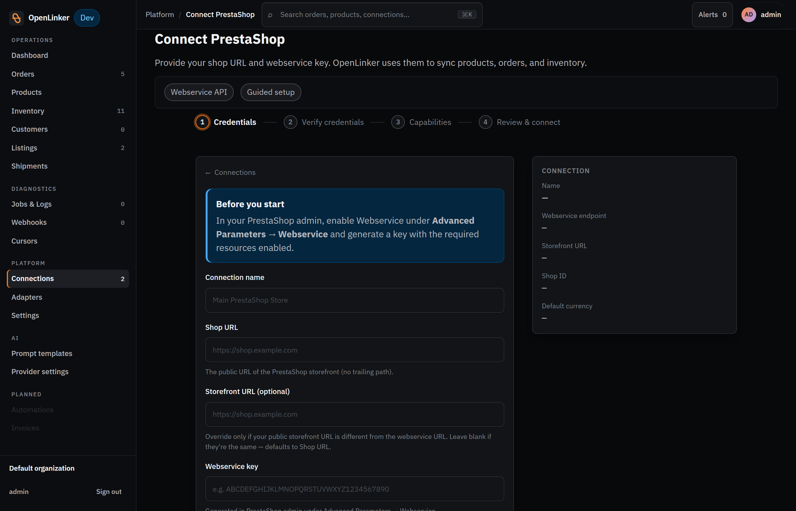

| Field | Description |
|---|---|
| **Connection name** | A human-readable label, e.g. `Main store` |
| **Shop URL** | Base URL of the PrestaShop install, e.g. `http://localhost:8080/` |
| **Storefront URL** *(optional)* | Public-facing URL if different from the admin URL |
| **Webservice key** | The API key generated above |
| **Shop ID** *(optional)* | Leave blank for a standard single-shop install |
| **Default currency** *(optional)* | Override the shop's default currency for this connection |

Click **Create connection**. OpenLinker validates the credentials and, if successful, redirects you to the connection detail page.

### Step 2 — Test the connection

On the connection detail page, click **Test connection** in the **Actions** tab.

<!-- screenshot: PrestaShop connection detail — Actions tab, with "Connection OK" toast notification visible at bottom-right -->
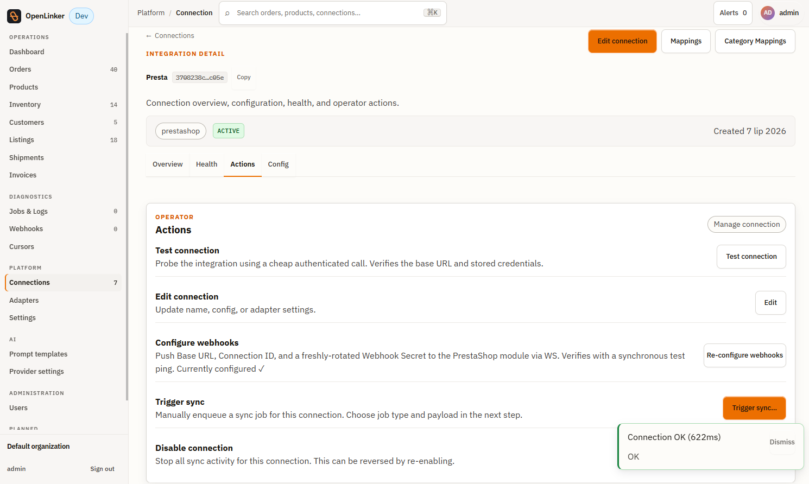

A **Connection OK** toast confirms the webservice key is valid and all registered capabilities resolve correctly.

If the test fails, check:
1. The shop URL includes a trailing slash and is reachable from the OpenLinker host
2. The webservice is enabled in PrestaShop (**Advanced Parameters → Webservice → Enable**)
3. The key has at least `GET` permissions on the required resources

### Connection detail tabs

The connection detail page has four tabs:

- **Overview** — platform type, adapter key, status chip, and configured capabilities
- **Health** — per-capability diagnostic checks and recent job activity for this connection
- **Actions** — Test connection, Edit connection, Configure webhooks, Trigger sync, Disable connection
- **Config** — current configuration values stored for this connection

<!-- screenshot: PrestaShop connection Health tab showing diagnostic checks and recent jobs -->
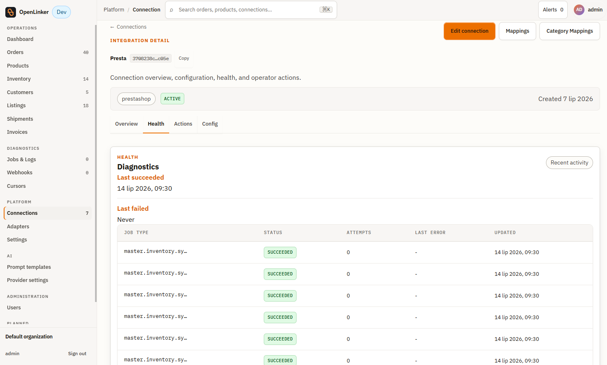

### Category Mappings

The PrestaShop connection detail also exposes a **Category Mappings** page, accessible from the connection's action bar. This is where you map your PrestaShop product categories to Allegro's category tree — a prerequisite for creating Allegro offers. See [Listings & Offers](./05-listings.md#category-mappings) for details.

---

## Allegro walkthrough

### Step 1 — OAuth credentials

After selecting **Allegro**, the wizard asks for OAuth credentials from your registered Allegro application:

<!-- screenshot: Allegro connection wizard — Credentials step showing Connection name, Client ID, Client secret fields and the OAuth/Allegro API tab selector -->
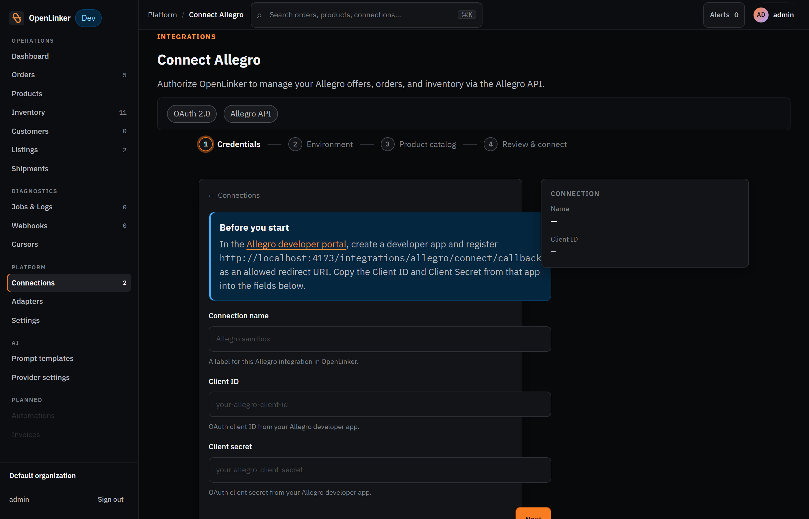

| Field | Description |
|---|---|
| **Connection name** | A human-readable label, e.g. `Allegro sandbox` |
| **Client ID** | From your Allegro developer application |
| **Client secret** | From your Allegro developer application |

The wizard also lets you configure the Allegro environment (Sandbox / Production) and link a PrestaShop product catalog.

> ⚠️ **Required defaults for Allegro**: The wizard includes a step to configure GPSR (General Product Safety Regulation) required fields and a default ship-from location. These are required by Allegro for offer creation. Fill them in before finishing the wizard.

### Step 2 — Authorize via OAuth

After filling in credentials, the wizard redirects you to Allegro's authorization page. Log in to your Allegro account and authorize the application. You are redirected back to OpenLinker and the connection is saved.

### Step 3 — Verify

On the Allegro connection detail, click **Test connection**:

<!-- screenshot: Allegro connection detail — Actions tab with "Connection OK" toast notification -->
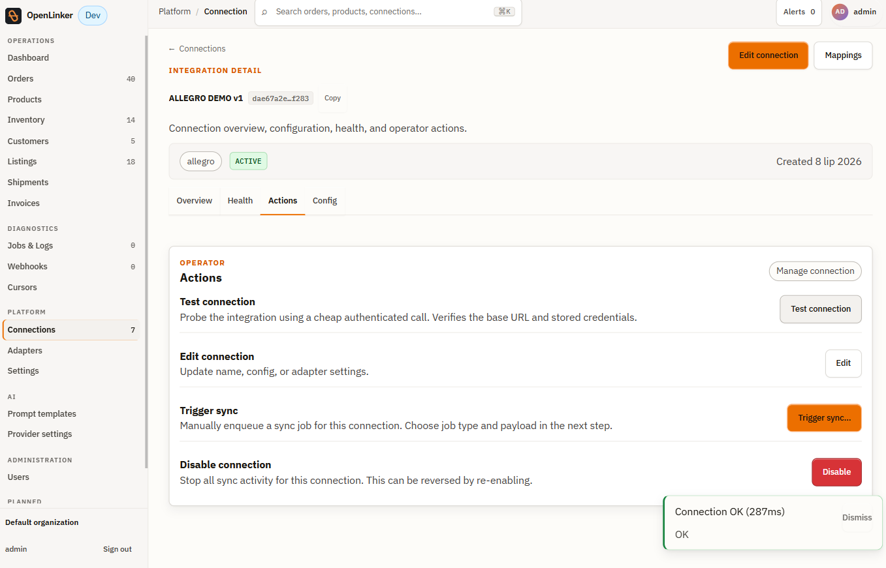

The **Connection OK** toast and the displayed response time confirm the Allegro API credentials are valid.

---

## Amazon walkthrough

Amazon is connected through the Selling Partner API (SP-API) with a private app you register in Seller Central. The steps on Amazon's side (registering the app, the roles to request, authorizing it to get a refresh token) are in the [Amazon setup guide](../../libs/integrations/amazon/docs/setup-guide.md#1-register-a-private-sp-api-app-and-request-roles). Have these ready before you start:

- the app's **LWA client id** and **LWA client secret**,
- the **refresh token** from authorizing the app,
- your **merchant token** (Seller Central: **Settings > Account info > Merchant token**), needed for offers and for the catalogue master.

### Step 1 — Region, environment and marketplaces

Go to **Connections > Add connection** and pick **Amazon**. The **Connect Amazon** form opens:

<!-- screenshot: Connect Amazon form - Connection name, Region (Europe), Environment (Production) and the Marketplaces picker with Germany and Poland chosen -->
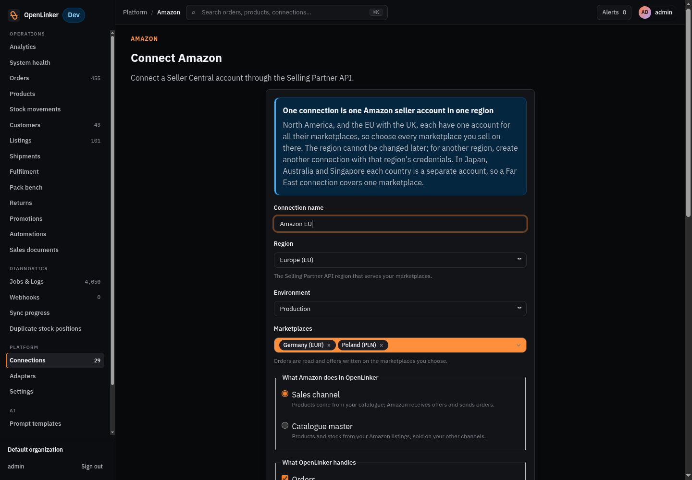

| Field | Description |
|---|---|
| **Connection name** | A label, e.g. `Amazon EU` |
| **Region** | The SP-API region that serves your marketplaces (Europe, North America, Far East) |
| **Environment** | **Production** for your account; **Sandbox** answers with Amazon's sample data only |
| **Marketplaces** | Where orders are read and offers written. In the Far East each country is a separate account, so choose one |

Region, environment and (in the Far East) the marketplace cannot be changed after saving: another region is another seller account, so it needs another connection.

### Step 2 — What Amazon does in OpenLinker

<!-- screenshot: Connect Amazon form - "What Amazon does in OpenLinker" with Sales channel selected and "What OpenLinker handles" with Orders and Offers ticked -->
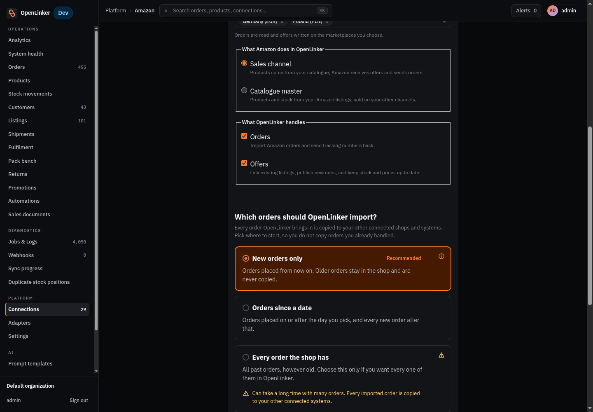

- **Sales channel**: products come from your catalogue (for example PrestaShop); Amazon receives offers and sends orders. Tick **Orders**, **Offers** or both.
- **Catalogue master**: products and stock come from your Amazon listings and are sold on your other channels. Offers stay off.

### Step 3 — Which orders to import

When **Orders** is ticked, the form asks where order sync starts:

<!-- screenshot: Connect Amazon form - "Which orders should OpenLinker import?" with the three cards, New orders only selected (Recommended) -->
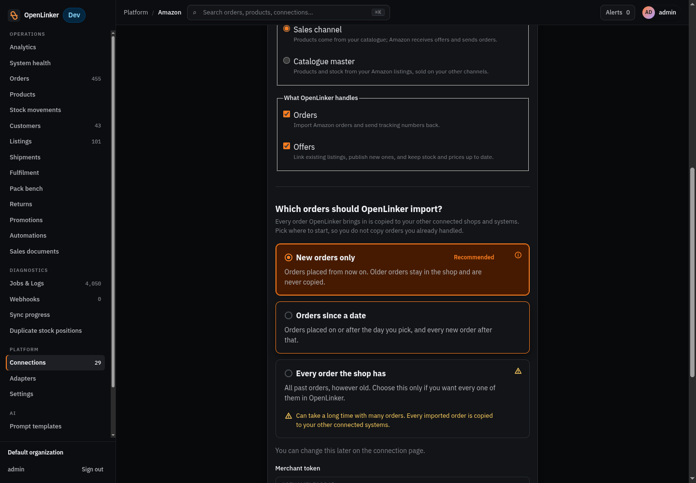

- **New orders only** (recommended): nothing placed before the connection is copied to your other shops and systems.
- **Orders since a date**: for Amazon this reads every order **updated** since that day (midnight UTC), so an older order that changed after it comes too.
- **Every order the shop has**: the whole account history. Amazon allows about one order search every three minutes, so a large history takes a long time.

Orders past Amazon's 30-day limit for buyer data arrive without the buyer's name, email and address. You can move the start or import older orders later from the connection's **Sync** tab (**Change where syncing starts...**).

### Step 4 — Credentials

<!-- screenshot: Connect Amazon form - Merchant token, LWA client id, LWA client secret, Refresh token fields and the collapsed "Order notifications (optional)" section -->
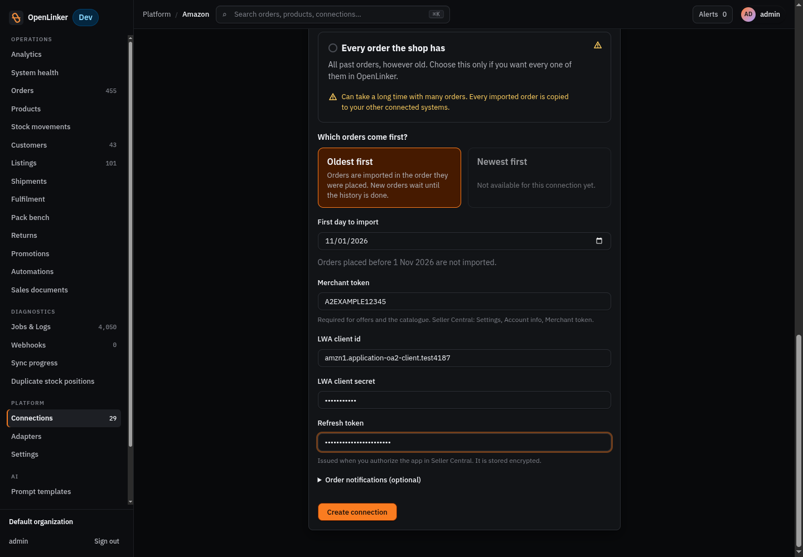

| Field | Description |
|---|---|
| **Merchant token** | Required for offers and the catalogue master |
| **LWA client id** / **LWA client secret** | From your SP-API app |
| **Refresh token** | Issued when you authorize the app; stored encrypted |
| **Order notifications (optional)** | An SQS queue URL and AWS keys, so order changes arrive within a minute instead of at the next poll. You can add them later |

Click **Create connection**.

### Step 5 — Test the connection

Click **Test connection**. It passes (**The connection works**) when the credentials work and the account sells in every marketplace you chose; if it names a marketplace, remove it from the connection or enable selling there in Seller Central. When Amazon refuses the credentials, the test says so:

<!-- screenshot: "Amazon connection created" followed by the red "The connection test failed - Amazon refused the credentials" result -->
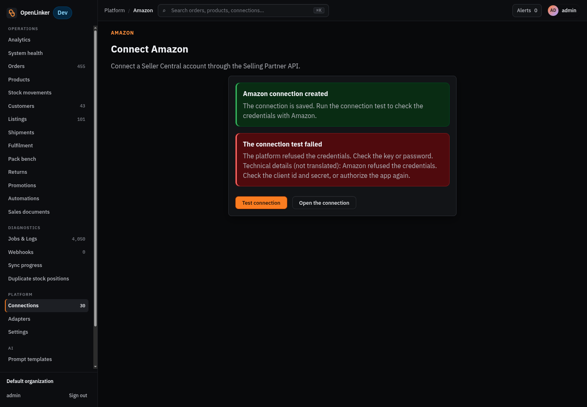

Check the LWA client id and secret, or authorize the app again in Seller Central for a new refresh token, then replace them in the connection's credentials panel. **Open the connection** takes you to the connection page.

### After the connection is created

The connection works with its defaults, but most accounts need a few settings on the connection page before orders and offers flow the way you want. The buttons at the top of the connection page lead to each of them: **Edit connection**, **Mappings** and **Pricing & sync**.

### Step 6 — Amazon settings (Edit connection)

<!-- screenshot: Edit connection for an Amazon sales channel - Marketplaces, Merchant token, VAT rates of Amazon tax codes, SQS queue URL, Send refunds to Amazon, Product catalog connection -->
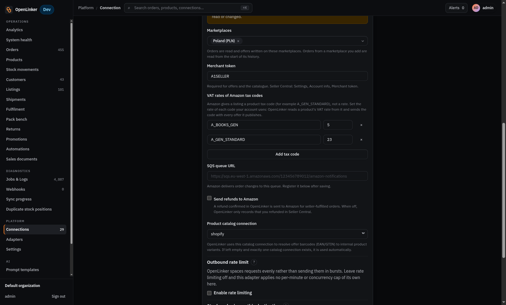

| Setting | What it does |
|---|---|
| **Marketplaces** | Add or remove marketplaces. The order feed shares one position across marketplaces, so adding one re-reads the history of all of them (already imported orders are updated, not duplicated). |
| **Merchant token** | Needed for offers and the catalogue master. |
| **VAT rates of Amazon tax codes** | Amazon gives a listing a product tax code (e.g. `A_GEN_STANDARD`), not a rate. Add a row for each code your account uses with its VAT rate: OpenLinker reads a product's rate from it and sends the code with every offer it publishes. |
| **SQS queue URL** | Optional queue for order notifications (Step 8). |
| **Send refunds to Amazon** | When on, a refund you confirm in OpenLinker is sent to Amazon for orders you ship yourself. When off, OpenLinker only records that you refunded in Seller Central. |
| **Product catalog connection** | For a sales channel: the catalogue (for example your shop) OpenLinker uses to match Amazon listings to your products by EAN/GTIN. If the connection page shows **Product catalogue not linked**, pick one here. |
| **Outbound rate limit** / **Stock and price on this destination** | Optional: pace requests, publish less stock than you hold, or publish a different price than your catalogue. |

Region, environment and (in the Far East) the marketplace are shown but cannot be changed: another region is another seller account and needs another connection.

### Step 7 — Stock locations and Multi-Channel Fulfillment (catalogue master)

When the connection is the **Catalogue master**, the edit page also asks where Amazon's stock goes:

<!-- screenshot: Edit connection for an Amazon catalogue master - Location of the stock you ship (FBM), FBA stock location, Multi-Channel Fulfillment shipping speed -->
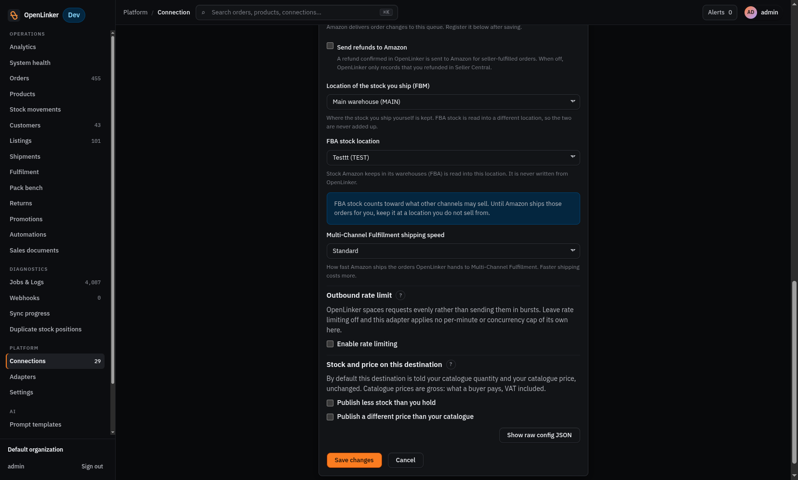

- **Location of the stock you ship (FBM)**: the warehouse location your own stock is kept in.
- **FBA stock location**: stock Amazon keeps in its warehouses is read into this location and never written from OpenLinker. FBA stock counts toward what other channels may sell, so until Amazon ships those orders for you (Multi-Channel Fulfillment), keep it at a location you do not sell from. **Do not read FBA stock** leaves it out.
- **Multi-Channel Fulfillment shipping speed**: Standard, Expedited or Priority for orders OpenLinker hands to Amazon to ship. Faster costs more. Details are in the [setup guide, section 6](../../libs/integrations/amazon/docs/setup-guide.md#6-multi-channel-fulfillment-optional).

Create the locations first: **Settings**, tile **Inventory locations** (`/inventory/locations`).

### Step 8 — Enabled roles and order notifications

The **Overview** tab lists what the connection does:

<!-- screenshot: Amazon connection Overview - Enabled roles: Order source and Marketplace offers ticked, Stock levels unavailable while OfferManager is selected -->
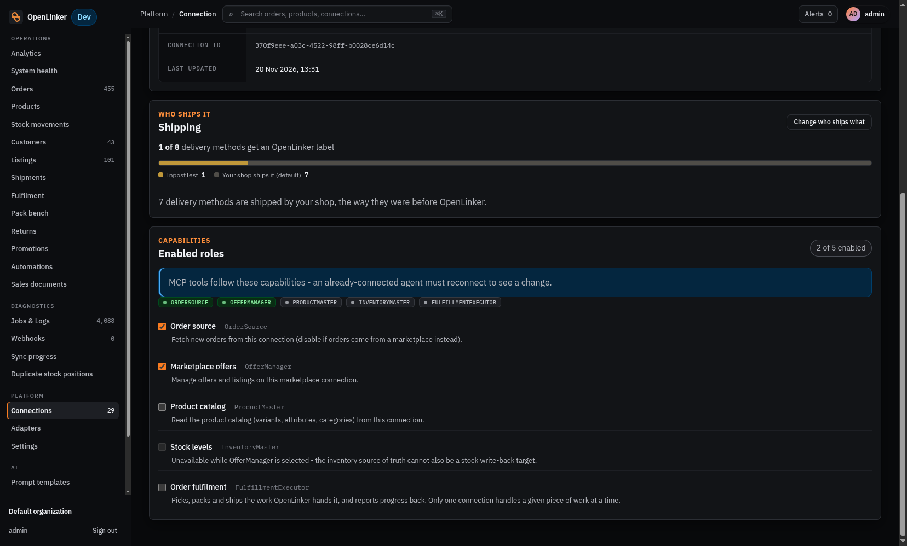

Tick or untick **Order source**, **Marketplace offers**, **Product catalog**, **Stock levels** and **Order fulfilment** here. **Stock levels** and **Marketplace offers** cannot both be on: a connection that is the source of stock is never also a target OpenLinker writes stock to.

Order notifications make order changes arrive within a minute instead of at the next scheduled check. Save the **SQS queue URL** (Step 6), enter the AWS access keys under **Credentials > Re-authorize** on the same edit page (or in **Order notifications** when you create the connection), then open the **Actions** tab and click **Register queue**:

<!-- screenshot: Amazon connection Actions tab - Test connection, Edit connection, Order notifications (Register queue), Trigger sync, Disable connection -->
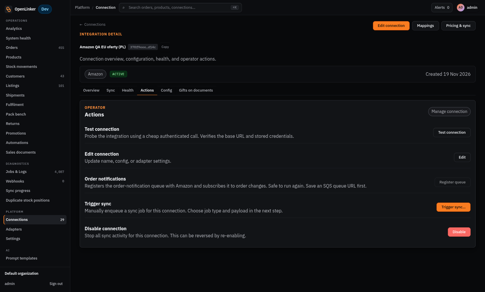

Registering is safe to run again. The **Actions** tab also has **Test connection**, **Trigger sync** (run any sync job now) and **Disable connection**.

### Step 9 — Mappings

**Mappings** sets how Amazon orders land in the system they are sent to:

<!-- screenshot: Mapping configuration Amazon -> Shopify - Fulfilment tab "Who ships each delivery method" with the Amazon delivery methods and a carrier per method -->
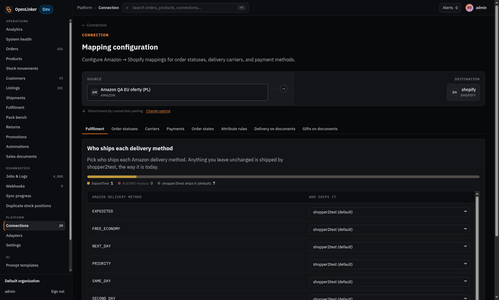

- **Fulfilment**: who ships each Amazon delivery method (`STANDARD`, `EXPEDITED`, `NEXT_DAY`, ...). Anything you leave unchanged is shipped the way it is today.
- **Order statuses**, **Carriers**, **Payments**, **Order states**: how Amazon's values are named in the destination.
- **Attribute rules**, **Delivery on documents**, **Gifts on documents**: listing attributes and what invoices and receipts show.

An order Amazon ships itself (FBA) is recorded as sent and needs no carrier.

### Step 10 — Pricing & sync

<!-- screenshot: Pricing & sync for an Amazon connection - Default pricing rule, Manual Review / Automatic, Give one source its own settings -->
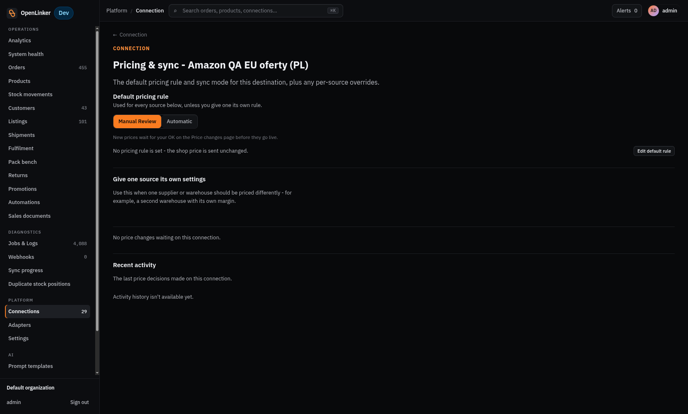

The price published to Amazon is your catalogue price unless you set a rule here. **Manual Review** holds new prices on the **Price changes** page until you approve them; **Automatic** publishes them at once. **Give one source its own settings** sets a different margin for one supplier or warehouse.

### Step 11 — Turn on the background tasks

Amazon's background tasks (importing orders, linking listings, refreshing stock and prices, returns) are **off by default** and switched on in the worker's environment, for example `OL_AMAZON_ORDERS_POLL_SCHEDULER_ENABLED=true` for importing orders every 5 minutes. The full list and what each one does is in the [setup guide, section 7](../../libs/integrations/amazon/docs/setup-guide.md#7-background-tasks).

<!-- screenshot: Amazon connection page - Sync tab, Order import panel: "Not checked yet", "Starts on the next check: orders since 1 Nov 2026", Check for new orders -->
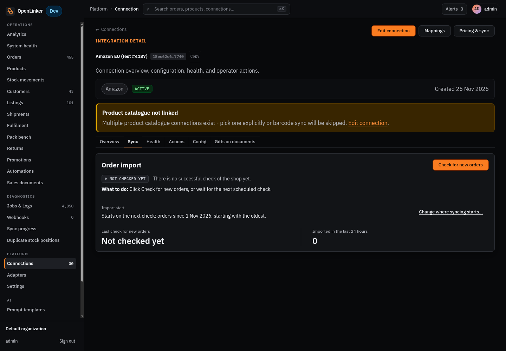

The connection's **Sync** tab (**Order import**) shows where syncing starts, the last check, orders imported in the last 24 hours and anything that could not be imported. **Check for new orders** runs the import at once instead of waiting for the next scheduled check; **Change where syncing starts...** moves the start to a date or the whole history.

---

### Where order sync starts

If the connection reads orders, the wizard asks where to start: **only new orders** (default), **from a date**, or **all orders**. Only the choices the platform supports are shown (Allegro and Erli have no "from a date"; for Amazon "from a date" counts orders updated since that day). Shopify shows orders from the last 60 days unless the app has the `read_all_orders` permission, and Subiekt GT needs an up-to-date bridge. You can change the start later on the connection's **Sync** tab; see [Orders](./06-orders.md#where-order-sync-starts) for details.

---

## Multiple connections

You can add multiple connections of the same platform type — for example, two PrestaShop stores and three Allegro accounts. Each connection has its own credentials, config, and set of scheduled sync jobs. The Insights and Jobs & Logs views aggregate across all connections.

---

## All available adapters

Every adapter registered in this OpenLinker instance — and the exact capabilities it implements — is listed read-only on the **Adapters** page (**Platform** → **Adapters**, `/adapters`). The platform picker's card list in **Add connection** reflects the same registry.

<!-- screenshot: Adapter catalog page — Adapter/Platform/Capabilities/Version columns for every registered adapter -->
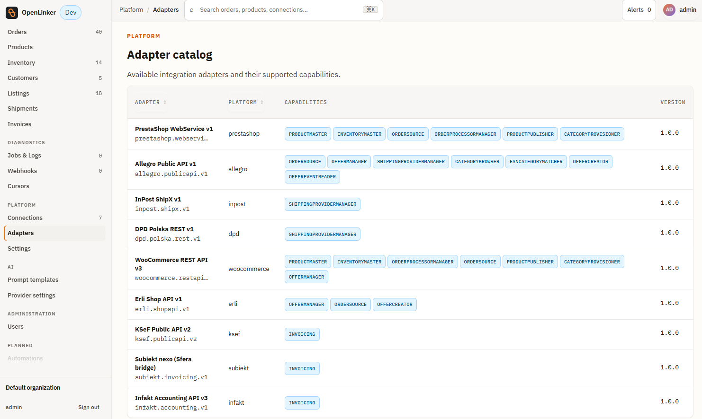

Beyond the PrestaShop/Allegro worked example above:

| Platform | Adapter key | Capabilities | Notes |
|---|---|---|---|
| **PrestaShop** | `prestashop.webservice.v1` | ProductMaster, InventoryMaster, OrderSource, OrderProcessorManager, ProductPublisher, CategoryProvisioner | Worked example above |
| **Allegro** | `allegro.publicapi.v1` | OrderSource, OfferManager, ShippingProviderManager, CategoryBrowser, EanCategoryMatcher, OfferCreator, OfferEventReader | Worked example above |
| **WooCommerce** | `woocommerce.restapi.v3` | ProductMaster, InventoryMaster, OrderProcessorManager, OrderSource, ProductPublisher, CategoryProvisioner, OfferManager | See the **[WooCommerce Setup Guide](../../libs/integrations/woocommerce/docs/setup-guide.md)** |
| **Shoper** | `shoper.restapi.v1` | ProductMaster, InventoryMaster, ProductPublisher, CategoryProvisioner, OrderProcessorManager, OrderSource, ShopCategoryBrowser, ShopAttributeReader, ShopProductStatusReader | Polish SaaS shop platform. Only ProductMaster and InventoryMaster are enabled by default; enable the rest on the connection when Shoper should also receive orders, send its own orders or take published products. Every connection to one shop shares that shop's request budget. No invoices: the Shoper API has none. See the [adapter README](../../libs/integrations/shoper/README.md) |
| **Erli** | `erli.shopapi.v1` | OfferManager, OrderSource, OfferCreator | Reconciliation-first marketplace adapter; reuses an existing PrestaShop → Allegro category/attribute mapping rather than requiring a separate one (borrowed-taxonomy model). Static API-key auth — no OAuth step. |
| **InPost** | `inpost.shipx.v1` | ShippingProviderManager | Generates shipment labels and paczkomat (parcel-locker) tracking, surfaced in the order's [Shipment panel](./06-orders.md#shipment-panel) |
| **DPD Polska** | `dpd.polska.rest.v1` | ShippingProviderManager | Same shipment-panel integration point as InPost |
| **KSeF** | `ksef.publicapi.v2` | Invoicing | Polish national e-invoicing; see [Invoices](./04-invoices.md) |
| **Subiekt GT** (Sfera GT bridge) | `subiekt.gt.v1` | Invoicing, ProductMaster, InventoryMaster, OrderSource, OrderProcessorManager | InsERT GT, reached through COM automation. Serves the catalogue, stock and orders as well as invoices; see the **[Subiekt GT setup guide](../../libs/integrations/subiekt/docs/setup-guide.md)** |
| **Subiekt nexo** (Sfera bridge) | `subiekt.nexo.v1` | Invoicing | A **different** InsERT product on a **different** bridge — not a variant of Subiekt GT. Invoicing only; see the **[Subiekt nexo setup guide](../../libs/integrations/subiekt-nexo/docs/setup-guide.md)** |
| **inFakt** | `infakt.accounting.v1` | Invoicing | Alternative invoicing provider; see [Invoices](./04-invoices.md) |
| **eparagony.pl** | `eparagony.documents.v3` | Fiscalization, Invoicing | Registers Polish fiscal e-receipts with your own fiscal printer; see [Fiscal receipts](./04a-fiscal-receipts.md). Since #3192 the same connection can also issue invoices (the vendor relays them to KSeF); the invoice lane is enabled separately |

### Invoicing providers

To issue invoices for orders, add a connection to any one of the **Invoicing**-role adapters above (KSeF, Subiekt GT, Subiekt nexo, inFakt, or eparagony.pl) the same way you'd add a shop or marketplace connection: **New connection** → pick the provider → fill in its credentials form → **Test connection**. KSeF in particular requires a Polish NIP and a KSeF authorization token generated from the taxpayer's own KSeF portal — see the [KSeF setup guide](../../libs/integrations/ksef/docs/setup-guide.md) for the full flow and current limitations.

Once the connection is `active` and has `Invoicing` in its enabled capabilities, the **Invoice** panel appears on every order's detail page. See [Invoices](./04-invoices.md) for the full walkthrough.

---

## What's next

With at least one shop connection active and catalog synced:

→ **[Catalog & Inventory](./03-catalog-and-inventory.md)** — browse the synced product catalog and inventory levels
