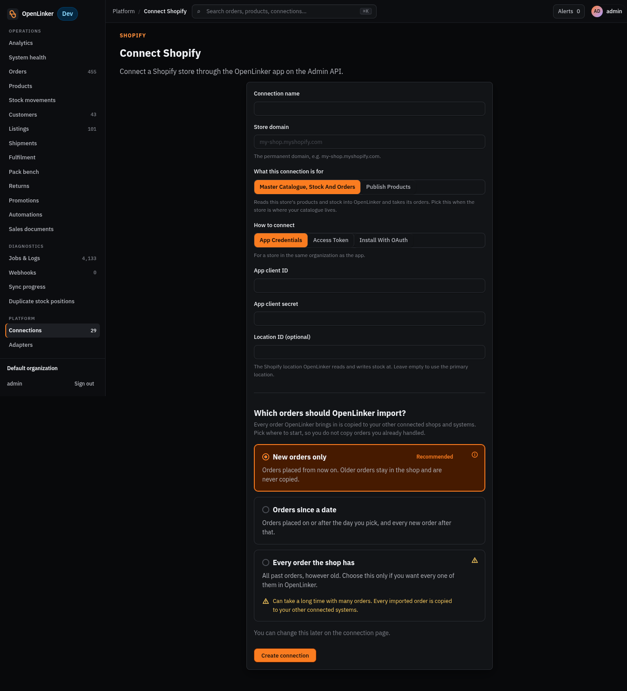
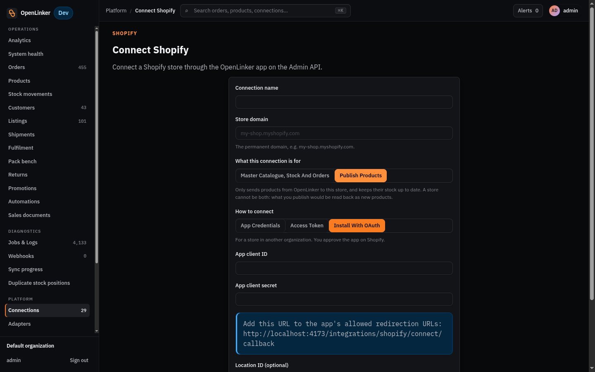
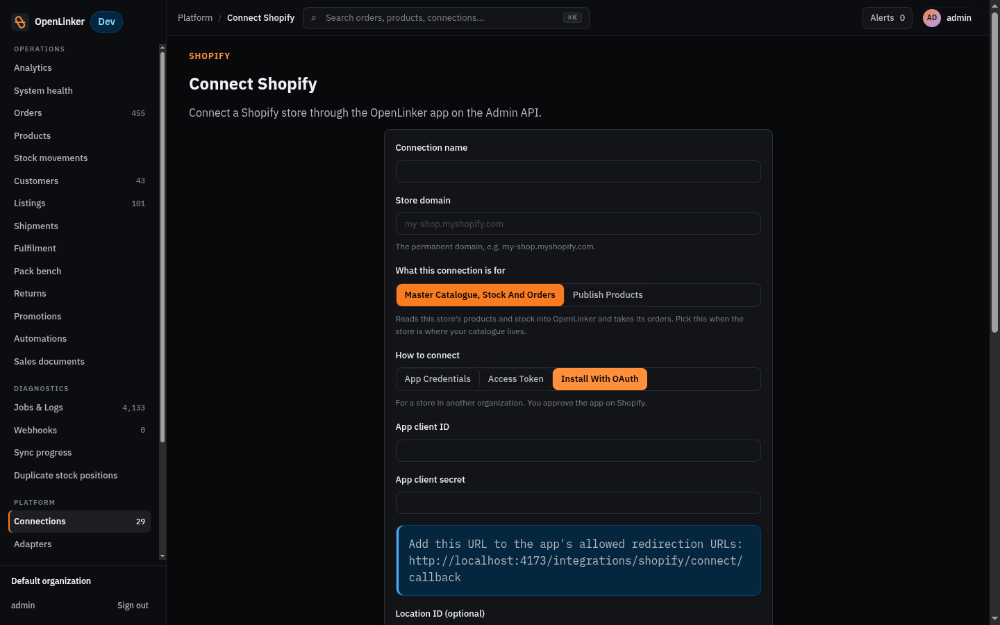
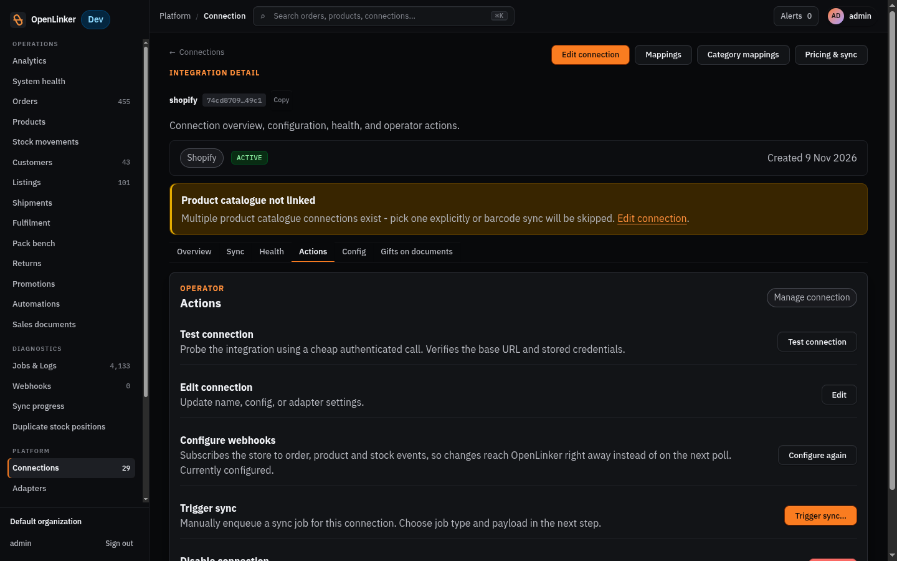
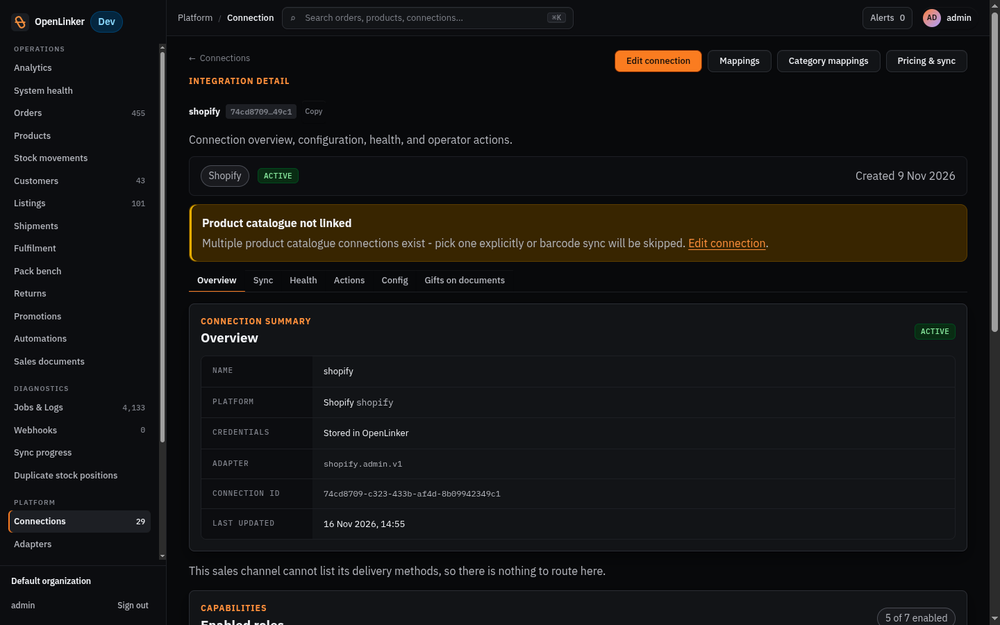
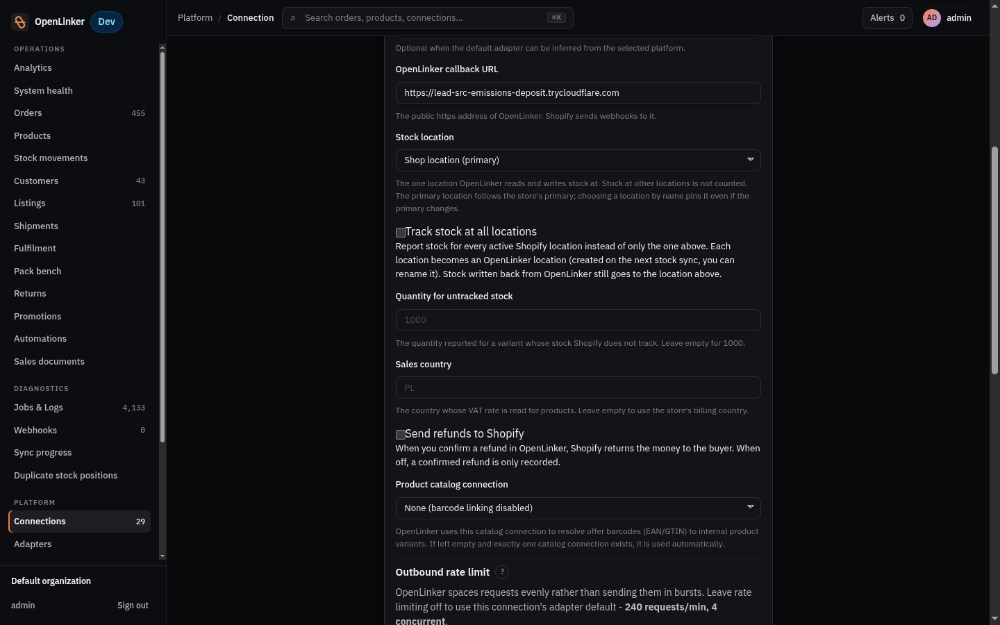

# Connecting Shopify

How to connect a Shopify store to OpenLinker and configure it. For the other platforms see [Connecting a Platform](./02-connecting-a-platform.md).

OpenLinker reaches Shopify through an app on the Admin API (GraphQL, version 2026-10). The steps on Shopify's side (creating the app in the Shopify Dev Dashboard, its scopes, releasing and installing it) are in the [Shopify setup guide](../../libs/integrations/shopify/docs/setup-guide.md). Have these ready before you start:

- the store's **permanent domain** (`your-store.myshopify.com`, never a custom domain),
- the app's **client ID** and **client secret**, or an **Admin API access token** (`shpat_...`) already issued for the store.

## Step 1 — Store and role

Go to **Connections > Add connection** and pick **Shopify**. The **Connect Shopify** form opens:

<!-- screenshot: Connect Shopify form - Connection name, Store domain, "What this connection is for" (Master catalogue, stock and orders), "How to connect" (App credentials), client ID and secret, Location ID and "Which orders should OpenLinker import?" -->

| Field | Description |
|---|---|
| **Connection name** | A label, e.g. `Shopify PL` |
| **Store domain** | The permanent `*.myshopify.com` domain |
| **What this connection is for** | **Master catalogue, stock and orders** or **Publish products** (see below) |
| **Location ID (optional)** | The Shopify location stock is read and written at. Leave it empty for the primary location; you can pick it from a list later |

**What this connection is for** decides the roles the connection starts with:

- **Master catalogue, stock and orders**: OpenLinker reads the store's products and stock, and takes its orders. Pick this when the store is where your catalogue lives.
- **Publish products**: OpenLinker only sends products from another catalogue (for example PrestaShop) to this store and keeps their stock up to date. Order history is not asked for.

<!-- screenshot: Connect Shopify form with "Publish products" selected - the description says a store cannot be both, and the order history section is gone -->

A store cannot be both on one connection: everything OpenLinker publishes would be read back as a new master product. To do both, create two connections to the same store.

## Step 2 — How to connect

| Way | Enter | Use when |
|---|---|---|
| **App credentials** | client ID + client secret | The store is in the **same organization** as the app (your own store or your company's). OpenLinker gets a token from them and renews it itself |
| **Access token** | `shpat_...` token | A token was already issued for the store. It is used as is and never renewed. Webhooks need the client secret, so a token alone gets no webhooks |
| **Install with OAuth** | client ID + client secret, then approve on Shopify | The store is in **another organization** (a merchant's own store) |

For **Install with OAuth** the form shows the address to add to the app's allowed redirection URLs. Add it in the Dev Dashboard first, then click **Continue to Shopify** and approve the app; Shopify sends you back to OpenLinker and the connection is created.

<!-- screenshot: Connect Shopify form with "Install with OAuth" selected - the redirection URL hint and the "Continue to Shopify" button -->

App credentials on a store in another organization fail with "store in another organization": use OAuth there.

## Step 3 — Which orders to import

With **Master catalogue, stock and orders** the form asks where order sync starts:

- **New orders only** (recommended): nothing placed before the connection is copied to your other shops and systems.
- **Orders since a date**: orders placed on or after that day, and every new one.
- **Every order the shop has**: the whole history.

Without the `read_all_orders` permission Shopify shows OpenLinker only the last 60 days of orders, whatever you pick. You can change the start later on the connection's **Sync** tab; see [Orders](./06-orders.md).

Click **Create connection** (or **Continue to Shopify** for OAuth).

## Step 4 — Test the connection

Open the connection and go to the **Actions** tab. Click **Test connection**. It reports the shop name, currency, whether prices include tax and the stock location, and lists every missing app permission with what it switches off.

<!-- screenshot: Shopify connection - Actions tab with Test connection, Edit connection, Configure webhooks (currently configured), Trigger sync and Disable connection -->

| Test says | What to do |
|---|---|
| App not installed | Install the app on the store from its page in the Dev Dashboard |
| Store in another organization | Delete the connection and connect with **Install with OAuth** |
| Missing permissions | Add them to a new app version, release it, then press **Update** on the "needs access to" prompt in the store admin. Releasing alone grants nothing |

## Step 5 — Roles

The **Overview** tab lists the connection's roles under **Enabled roles**. A new master connection has **Product catalog** and **Stock levels** on.

<!-- screenshot: Shopify connection - Overview tab with Enabled roles: Product catalog, Stock levels, Order source, Order destination, Shop listings, Marketplace offers, Category setup -->

| Role | Turn on when |
|---|---|
| **Product catalog**, **Stock levels** | The store is your catalogue and stock |
| **Order source** | Orders placed in the store should come into OpenLinker. Returns come with it |
| **Order destination** | Orders from your marketplaces (Allegro, Amazon, ...) should be created in the store. Shopify lowers its own stock for each one |
| **Shop listings**, **Category setup**, **Marketplace offers** | You publish products from another catalogue to this store. Use a separate publish-only connection with **Product catalog** and **Stock levels** off |

## Step 6 — Settings

Click **Edit connection**. The Shopify settings are under **OpenLinker callback URL**:

<!-- screenshot: Edit connection - OpenLinker callback URL, Stock location picker, Track stock at all locations, Quantity for untracked stock, Sales country, Send refunds to Shopify -->

| Field | Description |
|---|---|
| **OpenLinker callback URL** | OpenLinker's public `https` address. Shopify sends webhooks to it |
| **Stock location** | The one location OpenLinker reads and writes stock at, picked from the store's active locations. **Shop location (primary)** follows the store's primary location; picking a location by name keeps it even if the primary changes |
| **Track stock at all locations** | Reports stock for every active Shopify location instead of only the one above. Each becomes an OpenLinker location on the next stock sync. Stock written back from OpenLinker still goes to the location above |
| **Quantity for untracked stock** | Stock reported for a variant Shopify does not track ("always available"). Empty means 1000 |
| **Sales country** | The country whose VAT rate is read for products. Empty means the store's billing country |
| **Send refunds to Shopify** | When on, confirming a refund in OpenLinker makes Shopify return the money to the buyer (Shopify Payments). When off, the refund is only recorded. It moves real money, so check every amount |

Click **Save changes**.

## Step 7 — Webhooks

Webhooks bring order, product and stock changes to OpenLinker within seconds. Without them the orders poll still picks changes up, every 5 minutes.

1. Set **OpenLinker callback URL** and save.
2. Make sure **Order source**, **Product catalog** or **Stock levels** is on: webhooks carry only those events.
3. On the **Actions** tab click **Configure webhooks**.

Run it again after turning on another role or changing the URL. It needs the client secret, so a connection made with an access token alone cannot get webhooks. If you rotate the client secret in the Dev Dashboard, update the connection's credentials and configure webhooks again; **Test connection** warns when the two no longer match.

## Step 8 — Mappings

When the store receives marketplace orders (**Order destination**), open **Mappings** on the source connection (for example Allegro) and map its delivery methods and payment methods to the store's own. Unmapped, the source's own names are used. Category mappings work on the store's Standard Product Taxonomy categories; see [Listings](./05-listings.md).

## What OpenLinker does with the store

- **Prices**: catalogue prices in OpenLinker are gross. A store whose prices exclude tax is converted with each product's VAT rate, which needs the `write_draft_orders` permission; a product whose rate cannot be read gets no price.
- **Orders from marketplaces** are created at the price the buyer paid, tagged `openlinker`, and Shopify sends the buyer no receipt. A locker pickup point goes into the order note and the shipping line title, because Shopify has no pickup-point field.
- **Dispatch**: when OpenLinker ships an order, Shopify gets the tracking number, carrier and link.
- **Products deleted in your catalogue** are hidden in Shopify (set to draft, kept with their history), and a hidden product can be shown again.
- **Published product status** (active, draft, archived, removed) is re-read hourly. This and the other background checks (orders every 5 minutes, fulfilments made in the Shopify admin, returns) run in the worker and are switched off with `OL_SHOPIFY_*_SCHEDULER_ENABLED=false`; the returns checks are off unless set to `true`. The list is in the [Shopify adapter README](../../libs/integrations/shopify/README.md#scheduler-tasks).
- **Returns** requested in Shopify are read in, and a requested return can be declined from OpenLinker.
- **Archived products** count as removed from sale, so their offers are paused. Draft products sync normally. Gift cards are skipped.

For the full behaviour see the [Shopify adapter README](../../libs/integrations/shopify/README.md).
