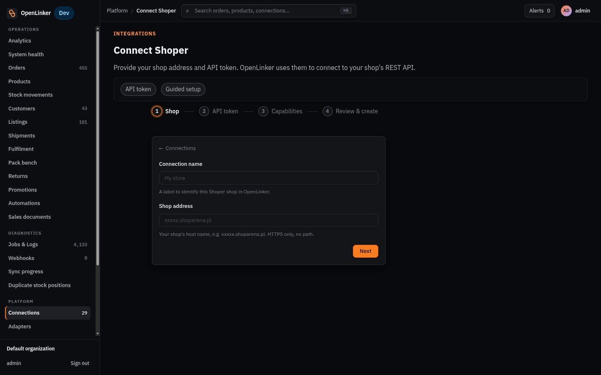
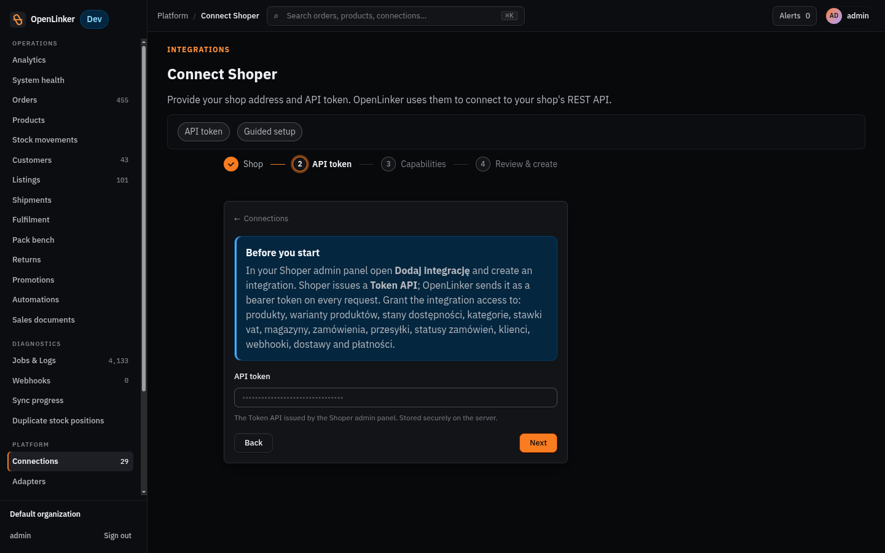
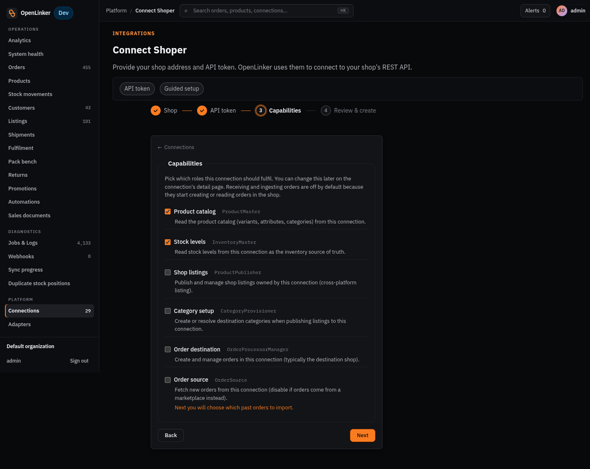
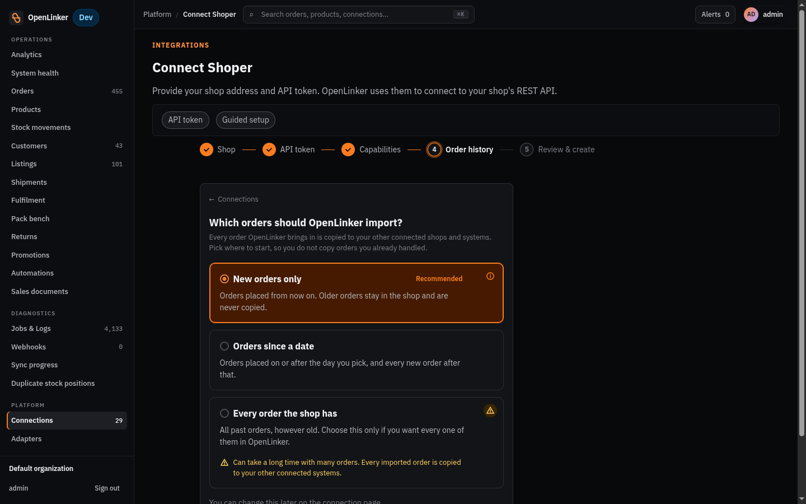
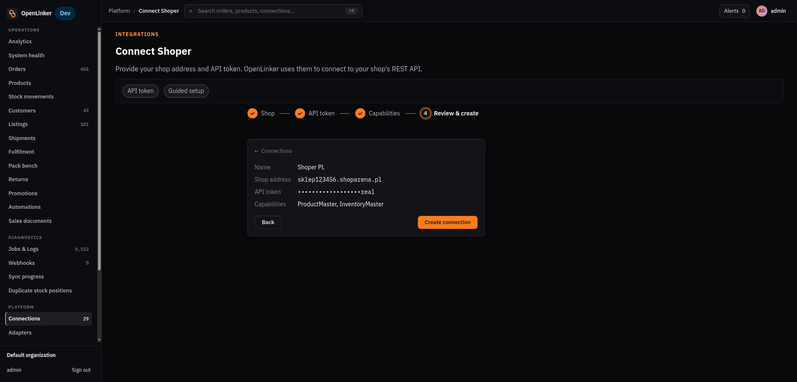
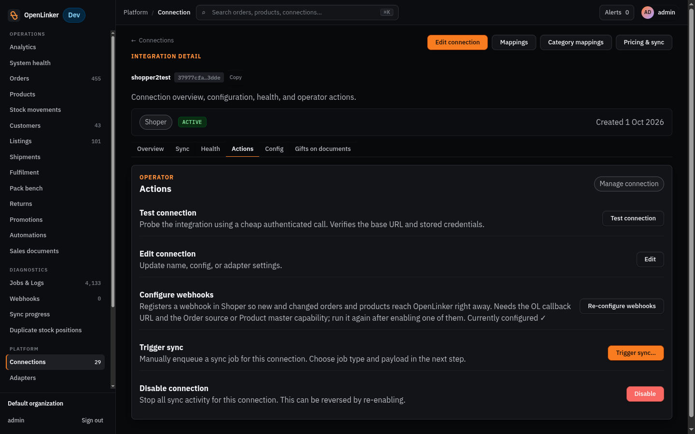

# Connecting Shoper

How to connect a Shoper shop to OpenLinker and configure it. For the other platforms see [Connecting a Platform](./02-connecting-a-platform.md).

OpenLinker reaches Shoper through the shop's REST API with an API token. Shoper has no invoices or receipts in its API, so sales documents for Shoper orders come from an invoicing connection (KSeF, inFakt, Subiekt, eparagony.pl).

## Before you start — create the integration in Shoper

The Shoper admin panel is in Polish only, so its labels are given here as they appear on screen, with a translation.

In the Shoper admin panel open **Dodaj integrację** (Add integration) and create an integration. Shoper issues a **Client ID** and a **Token API**; OpenLinker needs only the token.

In the integration's access table (**Obszar sklepu x Zakres dostępu**, shop area x access scope) grant access to all of these areas at once, so you do not have to come back:

| Area in the panel | What it covers |
|---|---|
| produkty | products |
| warianty produktów | product variants |
| stany dostępności | stock levels |
| kategorie | categories |
| stawki vat | VAT rates |
| magazyny | warehouses |
| zamówienia | orders |
| przesyłki | parcels |
| statusy zamówień | order statuses |
| klienci | customers |
| webhooki | webhooks |
| dostawy | delivery methods |
| płatności | payment methods |

Shoper checks access per area. The connection test needs none of them, so a passing test does not prove every area was granted; a missing area shows up as an error in the job that needs it.

## Step 1 — Shop

Go to **Connections > Add connection** and pick **Shoper**. A guided setup opens with four steps.

<!-- screenshot: Connect Shoper - step 1 Shop, with Connection name and Shop address -->

| Field | Description |
|---|---|
| **Connection name** | A label, e.g. `Shoper PL` |
| **Shop address** | The shop's host name, e.g. `sklep123456.shoparena.pl` or your own domain. `https` only, no path |

Click **Next**.

## Step 2 — API token

<!-- screenshot: Connect Shoper - step 2 API token, with the "Before you start" panel listing the areas to grant -->

Paste the **Token API** from the Shoper panel. It is stored encrypted on the server. Click **Next**.

## Step 3 — Roles

<!-- screenshot: Connect Shoper - step 3 Capabilities: Product catalog, Stock levels, Shop listings, Category setup, Order destination, Order source -->

**Product catalog** and **Stock levels** are on by default. The others are off, because they start creating or reading orders in the shop:

| Role | Turn on when |
|---|---|
| **Product catalog**, **Stock levels** | The shop is your catalogue and stock |
| **Order source** | Orders placed in the shop should come into OpenLinker |
| **Order destination** | Orders from your marketplaces (Allegro, Erli, ...) should be created in the shop |
| **Shop listings**, **Category setup** | You publish products from another catalogue to this shop. Use a separate connection with **Product catalog** off: one connection cannot be both, or everything published would be read back as new products |

You can change the roles later on the connection's **Overview** tab.

## Step 4 — Which orders to import

With **Order source** on, the next step asks where order sync starts:

<!-- screenshot: Connect Shoper - "Which orders should OpenLinker import?" with New orders only selected (Recommended) -->

- **New orders only** (recommended): nothing placed before the connection is copied to your other shops and systems.
- **Orders since a date**: orders placed on or after that day, and every new one.
- **Every order the shop has**: the whole history.

You can change the start later on the connection's **Sync** tab; see [Orders](./06-orders.md).

## Step 5 — Review and create

<!-- screenshot: Connect Shoper - step Review & create, with name, shop address, masked token and capabilities -->

Check the summary and click **Create connection**. Then open the connection, go to **Actions** and click **Test connection**:

| Test says | Meaning |
|---|---|
| Passed | The address is a Shoper shop and the token is valid |
| 401 | The token is wrong or was revoked |
| 403 | The request was refused: check the integration is active in the Shoper panel |
| 404 | The address is not a Shoper shop |

## Step 6 — Order defaults (when the shop receives orders)

Shoper needs a delivery method, a payment method and a status on every order it gets, and has no "any" value, so OpenLinker never guesses one. With **Order destination** on, click **Edit connection**; the **Order defaults** fields list the shop's own methods and statuses:

| Field | Description |
|---|---|
| **Default delivery method** | Used when the order's delivery method has no mapping |
| **Default payment method** | Used for every order: Shoper requires one and OpenLinker has no payment mapping |
| **Default order status** | Used when the order's status has no mapping. Pick the status new orders start in |
| **Delivery method for shipments** | Used for the parcel when OpenLinker marks an order shipped. The order's own method is tried first; Shoper refuses some carrier-integrated methods (InPost, DPD), and then this one is used, so pick a plain one |
| **Status for cancelled orders** | Where an order goes when OpenLinker cancels it in the shop |
| **Status for orders in progress** | Where an order goes when OpenLinker reports it in progress |

Map the delivery methods and order statuses of your marketplaces under **Mappings** on the source connection (for example Allegro); the defaults cover what is not mapped. An order that cannot be built (no default, a currency or tax rate the shop does not have, no buyer email) fails before anything is written to the shop.

## Step 7 — Webhooks

Webhooks bring new and changed orders and products to OpenLinker right away. Without them the orders poll still runs every 10 minutes.

1. Click **Edit connection** and check **OL callback URL**: OpenLinker's public address as Shoper can reach it. It is pre-filled with the API address; it must be reachable from the internet. Save.
2. Make sure **Order source** or **Product catalog** is on.
3. On the **Actions** tab click **Configure webhooks**.

<!-- screenshot: Shoper connection - Actions tab with Test connection, Edit connection, Configure webhooks (Currently configured), Trigger sync and Disable connection -->

Run it again after turning on another role. Each run creates a new secret, and every delivery is checked against it. Shoper does not retry a failed delivery, so the poll and the catalogue sync stay on as a backstop.

## What OpenLinker does with the shop

- **Request budget**: Shoper limits requests per shop, shared by every integration on it. OpenLinker uses at most 5 requests a second for all its connections to one shop, half of Shoper's limit, and leaves the rest to your panel and other integrations.
- **Variants**: each Shoper stock row is a variant, with its option names (for example `Colour: black`). The base row of a product with variants is not a variant: nobody can buy it.
- **Stock**: one pooled number per variant. A shop with the multi-warehouse module on is refused for stock, so keep such a connection to **Product catalog** only.
- **Marketplace orders** are created at the price the buyer paid. Shoper lowers its own stock for each line; OpenLinker never lowers it a second time. If the marketplace has not shown the buyer's phone yet, the order gets the placeholder `100000000` and the real number is filled in on the next sync.
- **Dispatch**: when OpenLinker ships an order, Shoper gets a parcel with the tracking number.
- **Tax rate** is read from the product's tax row in Shoper; a row whose name and value disagree is treated as unknown, never guessed.

Not supported yet: locker pickup points on orders created in the shop (the warehouse reads the point from the source order), and cancelling a Shoper order from OpenLinker, so a cancelled marketplace order keeps its units taken in Shoper until you cancel it in the shop.

For the full behaviour see the [Shoper adapter README](../../libs/integrations/shoper/README.md).
