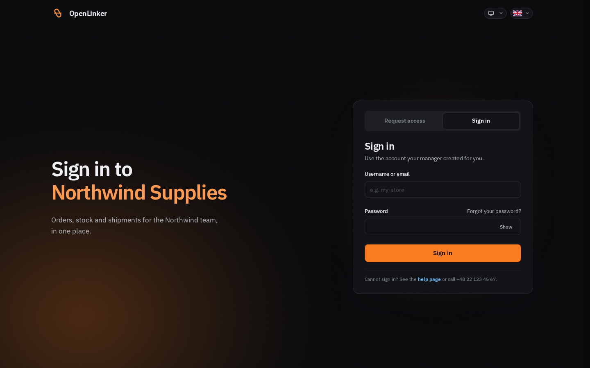
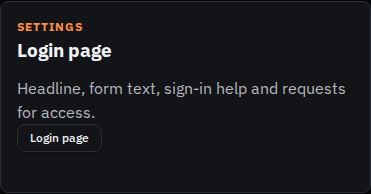
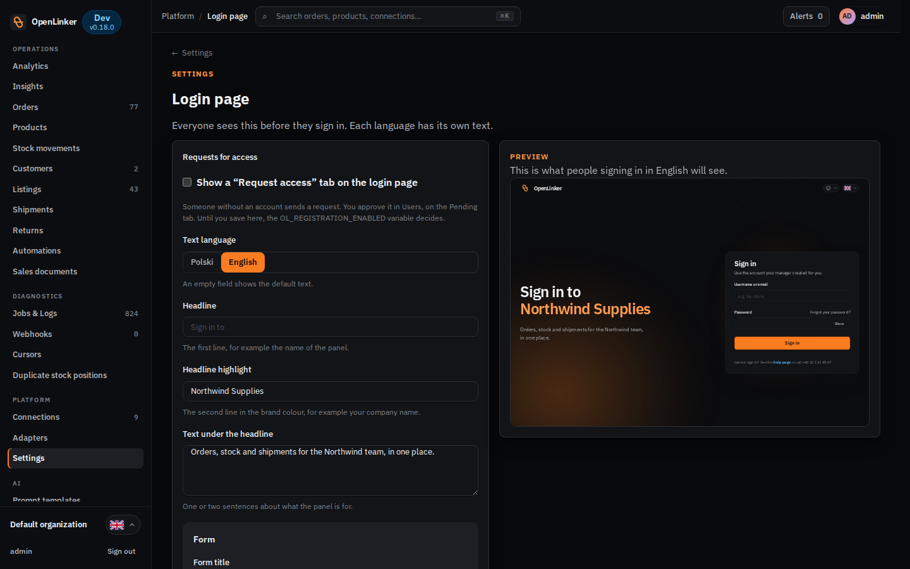
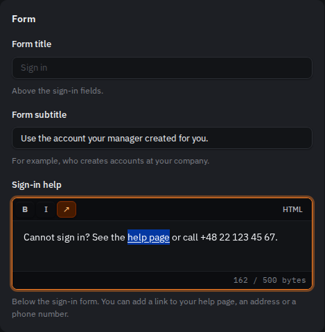
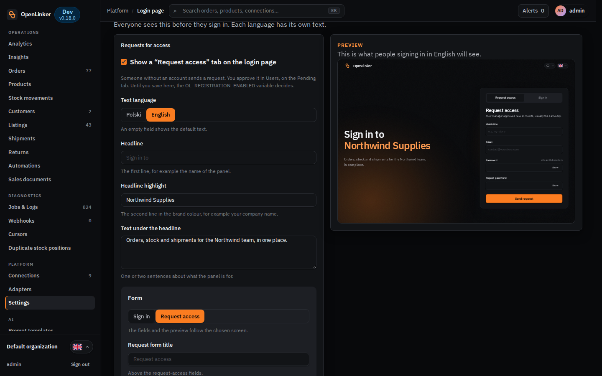
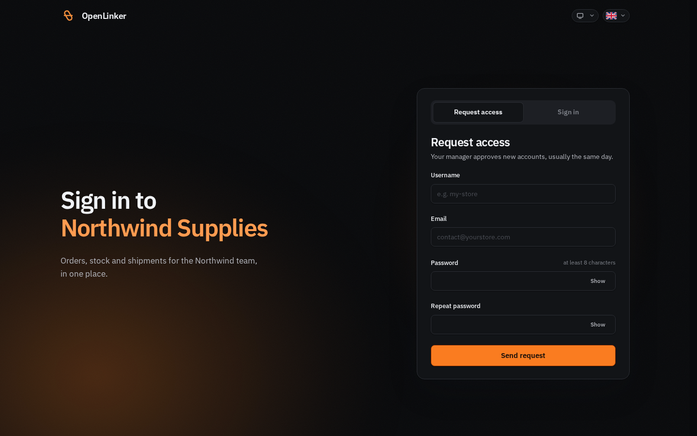
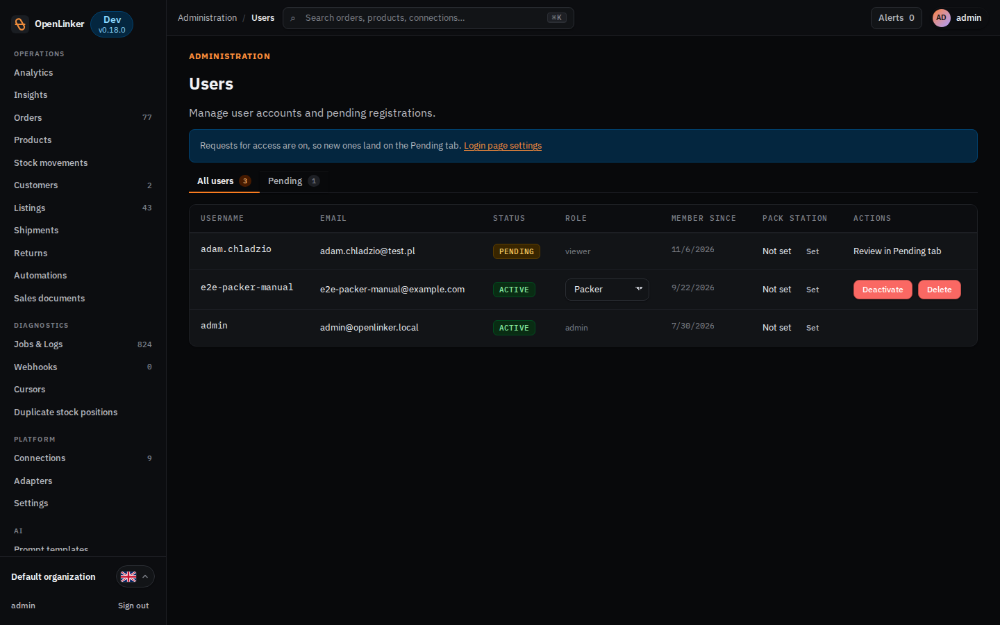
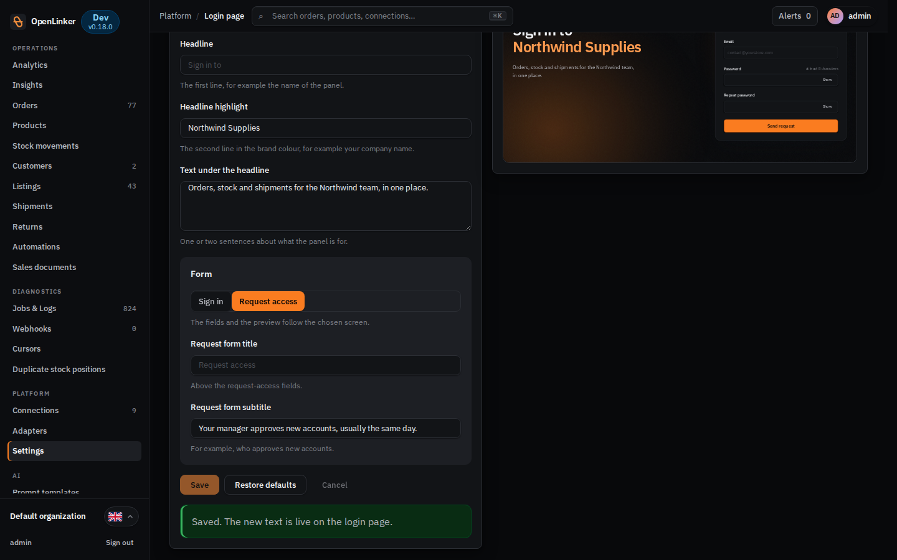
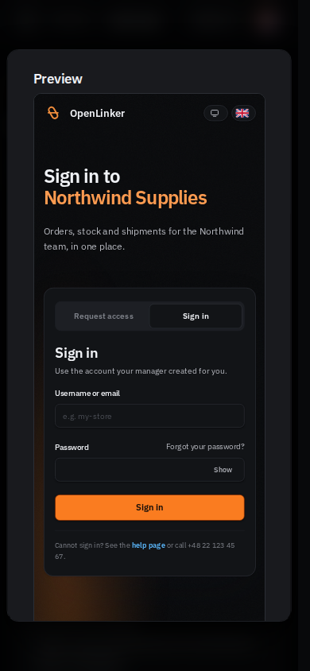

# Login page

The login page is the first thing your team sees. On your own install you can
change what it says: the headline, the text under it, the sign-in form's title
and subtitle, the help line under the form, and whether people without an
account can ask for one. Each language (Polish and English) has its own text.

All of this is done in **Settings → Login page**, with a live preview of the
real page next to the form. Nothing here needs a restart or a deploy: when you
save, the next person who opens the login page sees the new text.

> The public demo's login page has fixed text and is not edited here.

---

## Before you start

- You need the `admin` role. The page is not shown to other roles.
- Have your text ready in both languages if your team uses both. A field you
  leave empty shows OpenLinker's own default text, so you never end up with a
  blank page.

---

## Open the editor

Open **Settings** in the sidebar (under **Platform**) and click **Login page**
on its tile.

The editor has the form on the left and a preview of the real login page on
the right. The preview updates as you type and shows the language you are
editing.

---

## Change the headline and the text under it

These three fields are shared by both screens of the login page (signing in
and requesting access).

1. Under **Text language**, pick **Polski** or **English**.
2. **Headline** is the first line, in the normal text colour. The default is
   "Sign in to".
3. **Headline highlight** is the second line, in the brand colour. Put your
   company or team name here.
4. **Text under the headline** is one or two sentences about what the panel is
   for.
5. Switch the language and repeat for the other one.
6. Click **Save**.

| Field | Shown | Limit |
|---|---|---|
| Headline | first line of the headline | 60 characters |
| Headline highlight | second line, brand colour | 60 characters |
| Text under the headline | under the headline | 280 characters |

---

## Change the sign-in form

The **Form** card holds the fields of the sign-in form itself.

- **Form title** - above the fields. The default is "Sign in".
- **Form subtitle** - one line under the title. A good place to say where
  accounts come from, for example "Use the account your manager created for
  you."
- **Sign-in help** - a line under the form, for people who cannot get in.

### Add a link to your help page

**Sign-in help** is a small text editor, so it can hold a link:

1. Type the sentence, for example "Cannot sign in? See the help page or call
   +48 22 123 45 67."
2. Select the words that should become the link ("help page").
3. Click the link button (**↗**) in the editor's toolbar and paste the address.
4. To change or remove the link, select it and click the button again; an empty
   address removes it.

Bold and italic are there too. The field takes up to 500 bytes, including the
link's address; the counter under the editor shows how much of that is used.

Left empty, the help line says "Having trouble? Check the documentation" and
links to this documentation.

---

## Let people ask for an account

By default the login page only signs people in. To let someone without an
account send a request:

1. At the top of the editor, tick **Show a "Request access" tab on the login
   page**.
2. The **Form** card now has a switch between **Sign in** and **Request
   access**. Pick **Request access**: the fields below and the preview change
   to that screen.
3. Fill in **Request form title** and **Request form subtitle**, for example
   "Your manager approves new accounts, usually the same day."
4. Click **Save**.

| Field | Shown | Limit |
|---|---|---|
| Request form title | above the request fields | 60 characters |
| Request form subtitle | under that title | 140 characters |

The login page then has two tabs, **Request access** and **Sign in**:

### Approve a request

A request creates an account that cannot sign in yet. It waits on the
**Pending** tab of **Administration → Users**, where you **Approve** or
**Reject** it. While requests are switched on, the Users page says so and
links back to this editor:

To stop taking requests, untick the box and save. Accounts already approved
keep working.

### Link straight to a tab

A link can open the login page on the tab you want, for example from an
email or your intranet:

- `https://<your-openlinker>/login?tab=sign-up` opens **Request access**;
- `https://<your-openlinker>/login?tab=sign-in` opens **Sign in**.

The paths work the same way: `/register` opens **Request access** and
`/login` opens **Sign in**.

If requests for access are switched off, `/register` and `?tab=sign-up` show
the sign-in form with a short note that registration is turned off and an
administrator creates new accounts.

---

## Save, cancel or start over

- **Save** stores both languages at once and is live straight away.
- **Cancel** throws away what you changed since the last save.
- **Restore defaults** empties every field of the language you are looking at,
  so the page shows OpenLinker's default text again. It takes effect when you
  save.

A field that is too long is marked with how many characters it may hold, and
nothing is saved until it fits.

---

## On a phone

On a narrow screen there is no room for the preview beside the form. Tap
**Show preview** under the language switch: the preview opens in a window,
laid out the way the page looks on a phone.

---

## Set the text without the editor

If you deploy OpenLinker with environment variables, you can set the same text
there. The editor still wins: a value saved in **Settings → Login page** is
used first, then the variable, then OpenLinker's default.

Set these on the **API** service (one per field and language):

| Variable | Field |
|---|---|
| `OL_LOGIN_HEADLINE_PL`, `OL_LOGIN_HEADLINE_EN` | Headline |
| `OL_LOGIN_HEADLINE_ACCENT_PL`, `_EN` | Headline highlight |
| `OL_LOGIN_LEAD_PL`, `_EN` | Text under the headline |
| `OL_LOGIN_FORM_TITLE_PL`, `_EN` | Form title |
| `OL_LOGIN_FORM_SUBTITLE_PL`, `_EN` | Form subtitle |
| `OL_LOGIN_SUPPORT_PL`, `_EN` | Sign-in help |
| `OL_LOGIN_REGISTER_TITLE_PL`, `_EN` | Request form title |
| `OL_LOGIN_REGISTER_SUBTITLE_PL`, `_EN` | Request form subtitle |
| `OL_REGISTRATION_ENABLED` | `true` shows the Request access tab |

In the editor, a field set by a variable shows that value as its placeholder,
so you can see what the page says before you change it. Once you save the
switch for requests in the editor, `OL_REGISTRATION_ENABLED` no longer
decides; the editor says so under the switch until then.

---

## Good to know

- The theme (light or dark) and the language follow each visitor's own choice,
  from the switches in the top right corner of the login page.
- The help line is cleaned before it is stored and again before it is shown,
  so only text, bold, italic and links ever reach the page.

---

## Back to the guide index

[Operator Guide](./README.md)
