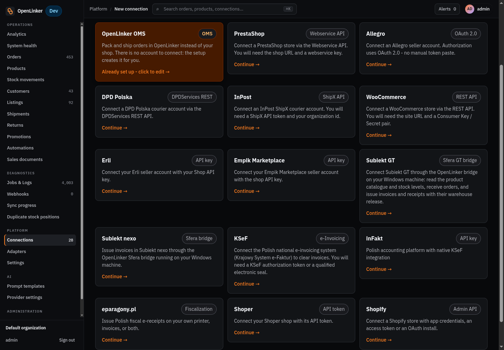
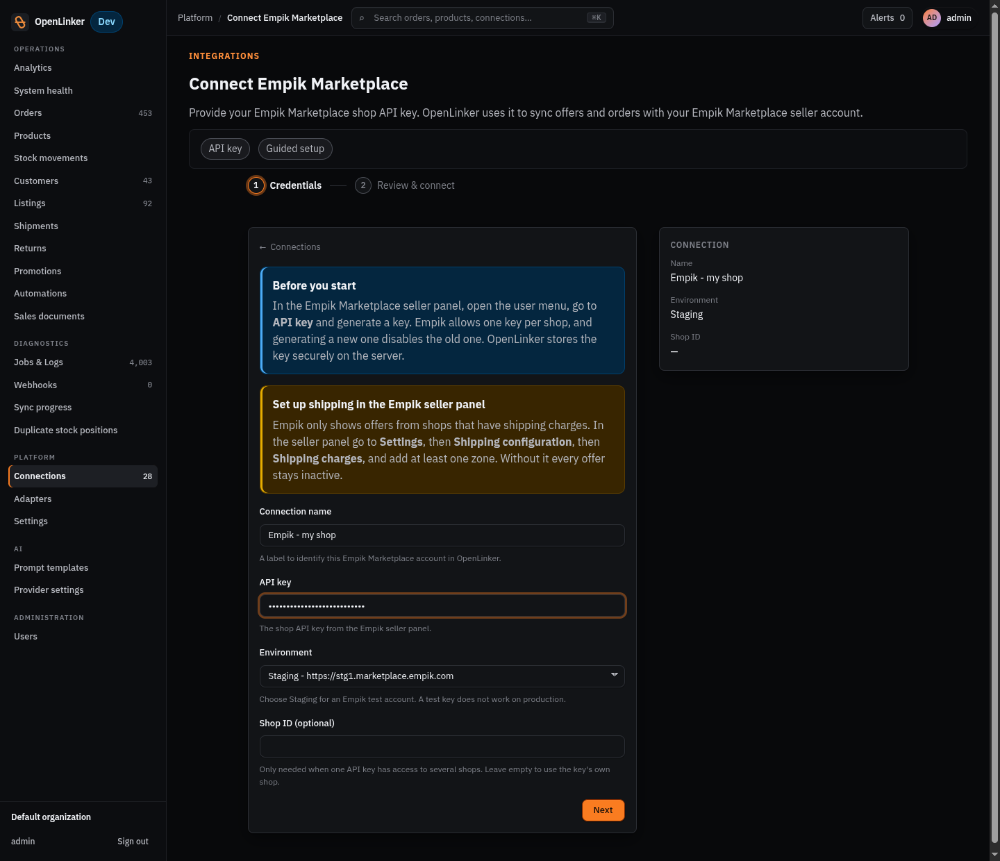
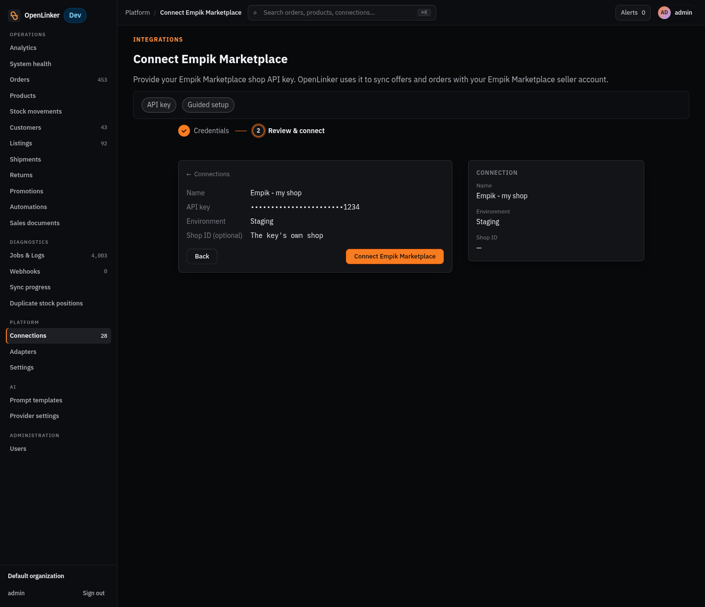
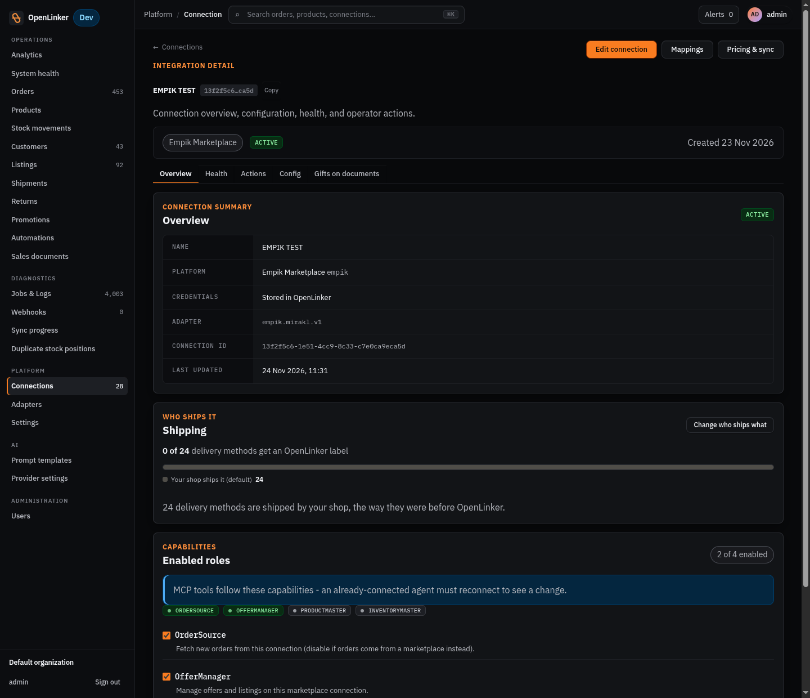
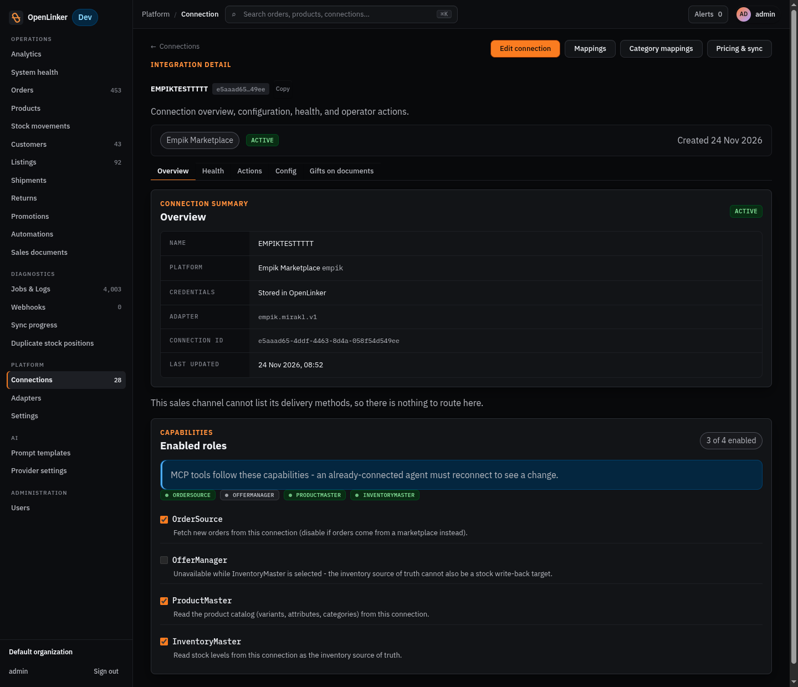
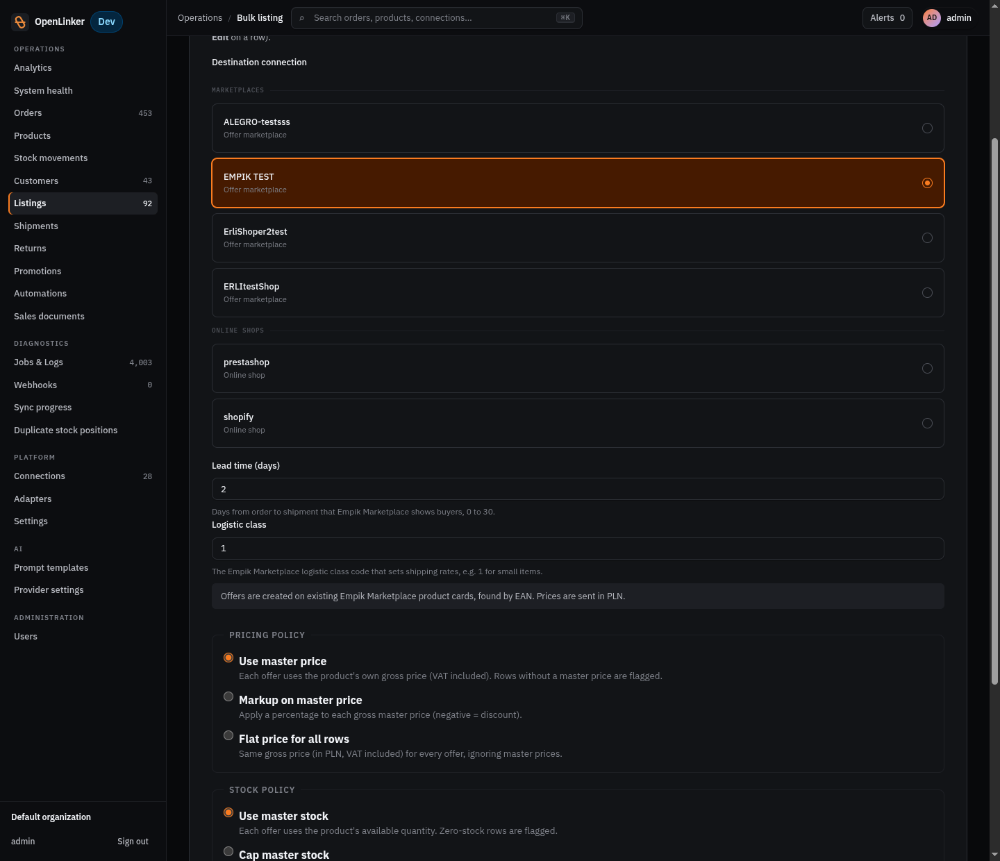

# Empik Marketplace Integration Setup Guide

This guide walks you through connecting an Empik Marketplace (EmpikPlace) seller
account to OpenLinker: what to set up in the Empik seller panel, how to create
the connection, which of the two ways to use it fits you, and how to list
offers, receive orders and keep stock in step.

Empik runs on Mirakl, so the connection is served by the shared Mirakl plugin
(`@openlinker/integrations-mirakl`, adapter key `empik.mirakl.v1`, platform type
`empik`). For the design, see
[ADR-088](../../../../docs/architecture/adrs/088-mirakl-plugin-with-operator-profiles.md);
for what each capability does call by call, see the [package README](../README.md).

## Prerequisites

- OpenLinker API, worker and web app running (the worker runs every Empik
  task: Mirakl sends sellers no webhooks, so everything is polled)
- PostgreSQL and Redis configured
- An Empik Marketplace seller account, production or test (staging)
- For listing offers: a catalogue connection (PrestaShop, WooCommerce, Shoper,
  Shopify, Subiekt) whose products carry EAN codes

## 1. Empik Seller Panel Setup

### API key

1. Log in to the Empik seller panel:
   - Production: `https://marketplace.empik.com`
   - Test: `https://stg1.marketplace.empik.com`
2. Open the user menu (top right) and go to **Klucz API**.
3. Generate a key and copy it.

Empik allows **one key per shop**. Generating a new one switches the old one
off, so after a rotation paste the new key into OpenLinker (see
[Rotating the API key](#rotating-the-api-key)). A test (staging) key answers
`401` on production and the other way round.

### Shipping charges (required)

Empik shows offers only from shops that have shipping charges set up, and
Mirakl offers no API for it. In the seller panel go to **Ustawienia** ->
**Konfiguracja wysyłki** -> **Opłaty za wysyłkę** and add at least one shipping
zone. Without one every offer stays inactive with the reason
`NO_MIN_SHIPPING_RATE`, which OpenLinker shows once per connection on the
listings page.

## 2. Environment Variables

No variable is required. The API key is stored encrypted in the
`integration_credentials` table, and the host (production or test) comes from
the connection, never from a URL you type: a key cannot be sent to a host the
Empik profile does not name.

Every scheduled task is on by default and can be switched off with its own
variable (read by the **worker**):

| Task | Every | Needs capability | Switch off with |
|---|---|---|---|
| `empik-orders-poll` (accepts and reads orders) | 5 min | `OrderSource` | `OL_EMPIK_ORDERS_POLL_SCHEDULER_ENABLED=false` |
| `empik-offer-writes` (stock and price files) | 5 min | `OfferManager` | `OL_EMPIK_OFFER_WRITES_SCHEDULER_ENABLED=false` |
| `empik-offers-sync` (links offers by SKU / EAN) | hourly | `OfferManager` | `OL_EMPIK_OFFERS_SYNC_SCHEDULER_ENABLED=false` |
| `empik-offer-status-sync` (active / inactive and why) | hourly | `OfferManager` | `OL_EMPIK_OFFER_STATUS_SYNC_SCHEDULER_ENABLED=false` |
| `empik-returns-poll` | 15 min | `OrderSource` | `OL_EMPIK_RETURNS_POLL_SCHEDULER_ENABLED=false` |
| `empik-returns-status-sync` | hourly | `OrderSource` | `OL_EMPIK_RETURNS_STATUS_SYNC_SCHEDULER_ENABLED=false` |
| `empik-master-stock-writes` (master mode only) | 1 min | `InventoryMaster` | `OL_EMPIK_MASTER_STOCK_WRITES_SCHEDULER_ENABLED=false` |

A task runs only for connections that have its capability enabled.

## 3. Sandbox vs Production Configuration

### Test environment (staging)

- Seller panel and API: `https://stg1.marketplace.empik.com`
- Choose **Testowe** / **Staging** in the setup form.
- Category tree identity: `empik:staging`, so category mappings made on test do
  not mix with production ones.
- On test, card imports can wait for Empik's review indefinitely, and there may
  be no orders or returns to read until you place one.

### Production

- Seller panel and API: `https://marketplace.empik.com`
- Choose **Produkcja** / **Production** (the default).
- Category tree identity: `empik`.

## 4. Connection Creation Steps

### Step 1: Pick Empik Marketplace

Go to **Connections** -> **Add connection** and choose the **Empik
Marketplace** card.



### Step 2: Credentials

Fill in the form at `/connections/new/empik`:

| Field | Value |
|---|---|
| **Connection name** | A label for this Empik account, e.g. `Empik - my shop` |
| **API key** | The key from the seller panel |
| **Environment** | **Production** or **Staging** (test) |
| **Shop ID (optional)** | Only when one API key reaches several shops. Leave empty to use the shop the key belongs to. |



### Step 3: Review and connect

Check the summary and click **Connect Empik Marketplace**. The connection is
created as a **marketplace** connection: orders, returns and offers (see
[section 6](#6-connection-configuration) for the other mode).



### Step 4: Validate the connection

Click **Test connection**. OpenLinker calls Mirakl `A01` (`GET /api/account`)
with your key and shows whether the credentials were accepted and the response time. A failed test
names the reason: a wrong key or a key for the other environment answers
`401`.

> **Developer aside.** The same over the API:
>
> ```bash
> curl -X POST https://<api>/v1/connections \
>   -H "Authorization: Bearer <token>" -H "Content-Type: application/json" \
>   -d '{
>         "platformType": "empik",
>         "adapterKey": "empik.mirakl.v1",
>         "name": "Empik - my shop",
>         "credentials": { "apiKey": "<key>" },
>         "config": { "environment": "staging" }
>       }'
> curl -X POST https://<api>/v1/connections/<id>/test -H "Authorization: Bearer <token>"
> ```

The connection page shows the platform, the adapter (`empik.mirakl.v1`), where
the key is stored, and below it who ships Empik orders and the enabled roles.
A new connection has **OrderSource** and **OfferManager** ticked.



## 5. Two Ways to Use the Connection

A connection works in **one** of two modes. OpenLinker refuses a connection
that is both the stock source and a stock write-back target, so you choose.

| | Marketplace (default) | Catalogue and stock master |
|---|---|---|
| Who holds the catalogue | Your shop (PrestaShop, WooCommerce, ...) | Your Empik offers |
| Who holds stock | Your shop | Empik |
| OpenLinker lists offers on Empik | Yes | No |
| OpenLinker sends stock and price to Empik | Yes | Only for sales and corrections made in OpenLinker |
| Orders and returns | Yes | Yes |
| Capabilities | `OrderSource`, `OfferManager` (+ sub-capabilities) | `OrderSource`, `ProductMaster`, `InventoryMaster` |

### Marketplace mode

Nothing to change after creating the connection. Your shop stays the source of
truth, and OpenLinker:

- **accepts new orders** automatically (Mirakl `OR21`, every line) and reads
  them every 5 minutes;
- **sends stock and price** changes in one file per kind every 5 minutes
  (`STO01`, `PRI01`); Mirakl asks sellers not to import more often;
- **links offers** you already have on Empik to your products by SKU and EAN
  (hourly), and **reads their status** with Empik's reasons (hourly);
- **lists new offers** on existing Empik product cards (see
  [Listing offers](#listing-offers)).

### Catalogue and stock master mode

Use it when Empik is where you keep your catalogue and stock, and OpenLinker
should take products and stock from there (for example to sell the same goods
in another channel).

Two things work differently from a marketplace connection:

- **Empik orders are not packed in OpenLinker.** A connection that is a product
  master is treated as the seller's own shop, so with the OMS on, its orders
  are not sent to the pack bench (the order shows "came from your own shop").
  Pack Empik orders the way you do today. Orders from other channels are
  packed and routed as usual.
- **An Empik sale lowers Empik stock only if Empik does it.** OpenLinker does
  not lower stock in the master for a sale made in the master itself. Empik
  normally lowers the offer quantity on its own; this was not checked on
  staging (no test orders), so after the first real order check that the
  quantity in the Empik panel went down.

1. Open the connection. The **Overview** tab ends with **Capabilities -
   Enabled roles**.
2. Untick **OfferManager**. **InventoryMaster** is greyed out while
   OfferManager is ticked, and the other way round, so it becomes available
   only now.
3. Tick **ProductMaster** and **InventoryMaster**. Keep **OrderSource**.



What you get:

- **Products**: each Empik offer becomes one product with one variant, keyed by
  your shop SKU: title, description, brand, EAN, gross price, category and the
  card's picture. A card without a picture in Empik (most book cards) has no
  image in OpenLinker either. Empik gives sellers no VAT rate, so it stays empty.
  Two consequences: with `OL_TAX_RATE_STRICT_ENABLED=true` a sales document for
  an order of these products waits until the rate is known, and publishing them
  to a PrestaShop shop needs that connection's **Default tax-rule group**.
- **Stock**: the offer quantity. A change made in OpenLinker (a routed sale, a
  manual correction) is queued and sent every minute as one `STO01` file.
  Empik confirms the file a few minutes later. If it refuses a line, the
  refusal is logged and stays in the write queue, but OpenLinker has already
  counted the change: check the offer in the Empik panel.
- **Deletions**: an offer that disappears from Empik is treated as a product
  deleted at the master, so its listings in other channels pause.
- Writing the catalogue from OpenLinker is refused.

## 6. Connection Configuration

Options not on the setup form are set in the connection's config (Edit
connection -> raw JSON):

```json
{
  "environment": "production",
  "shopId": 2001,
  "orderAcceptance": "auto",
  "carrierCodes": { "dpd-polska": "dpd" },
  "offerDefaults": { "leadTimeToShip": 2, "logisticClass": "1" }
}
```

| Key | Meaning |
|---|---|
| `environment` | `production` (default) or `staging` |
| `shopId` | Only for a key that reaches several shops |
| `orderAcceptance` | `auto` (default) accepts every waiting order; `off` leaves acceptance to you in the Empik panel. Acceptance does not check stock. |
| `carrierCodes` | Carrier code Empik expects (`OR23`), keyed by the shipping connection's platform type. Overrides the built-in table (InPost to a parcel locker goes as `paczkomatyinpost`, other InPost as `inpostpaczkakurierska`). A carrier with no code is sent by name. |
| `offerDefaults` | Lead time (days) and logistic class every new offer needs; the offer wizard can override them per batch. |

### Rotating the API key

Generate a new key in the seller panel (the old one stops working at once),
then on the connection page use **Replace API key** and paste it.

### Listing offers

Empik offers sit on Empik's own product cards. OpenLinker lists a product only
when its EAN **already has a card** on Empik; creating new cards is not
supported yet.

1. Map your categories to Empik's tree (connection -> **Mappings**), so category
   and attribute rules apply.
2. Go to **Listings** -> **Create offer**, pick products and the Empik
   connection.
3. In the config step set the **lead time** and **logistic class** (prefilled
   from `offerDefaults`). Prices are sent in PLN.
4. On **Review**, a row without an EAN or without an Empik card is blocked with
   its reason before anything is sent.



Each offer is created with one Mirakl import. It reads **activating** while
Empik processes it, then **active**, or **inactive** with Empik's reason.

### What happens to an order

| You do in OpenLinker | Empik gets |
|---|---|
| Ship with a tracking number | `OR23` (carrier and number), then `OR24` (shipped) |
| Cancel | `OR29` for the whole order (refused once shipped) |
| Issue an invoice | `OR74` upload as "Faktura" (`CUSTOMER_INVOICE`) |
| Mark delivered or paid | Nothing: Empik moves the order to received and collects payment itself |

Empik keeps **one tracking number per order**; a second parcel's number is
logged and not sent. A shipment you enter in the Empik panel is read back into
OpenLinker.

## 7. Next Steps

- Connect the shop that holds your catalogue, if you have not yet.
- Map categories and attributes for listing.
- Link a shipping connection (InPost, DPD) and, if needed, set `carrierCodes`.
- Set up sales documents (invoice or receipt routing) for Empik orders.

## Troubleshooting

### Connection test fails with 401

The key is wrong, was replaced by a newer one, or belongs to the other
environment. Generate a key in the panel of the environment you chose and
rotate it in OpenLinker.

### Every offer is inactive with `NO_MIN_SHIPPING_RATE`

No shipping zone is set up in the seller panel. See
[Shipping charges](#shipping-charges-required).

### Offer inactive with `SHOP_NOT_OPEN` or `ZERO_QUANTITY`

The shop is not open on Empik yet, or the offer has no stock. The first is
shown once per connection, the second per offer.

### A row is blocked in the offer wizard

`MIRAKL_PRODUCT_CARD_MISSING`: Empik has no card for that EAN. Check the EAN in
your catalogue or ask Empik to create the card.

### Stock or price did not change on Empik

Changes leave every 5 minutes (every minute in master mode) as one file. An
import Empik reads as `COMPLETE` can still refuse some lines; the offer then
shows Empik's reason. A `429` from Empik is retried after its `Retry-After`
without spending a job attempt.

### Orders do not appear

Check that the `empik-orders-poll` task is not switched off and that the
connection has `OrderSource`. Orders still waiting for acceptance are not read
until they are accepted; with `orderAcceptance: "off"` accept them in the panel.
The first run reads the last 7 days.

### Creating the connection is refused with a capability conflict

`InventoryMaster` cannot sit beside `OfferManager` on one connection. Pick one
mode (see [section 5](#5-two-ways-to-use-the-connection)).

## Security Considerations

- The API key is stored encrypted and is never returned by the API.
- The host is taken from the Empik profile by environment, never from config,
  so a key cannot be sent elsewhere.
- One key per shop: rotating it in the panel cuts off any old copy at once.

## API Reference

Mirakl Seller API calls the plugin uses:

| Call | Purpose |
|---|---|
| `A01` | Connection test |
| `OR11`, `OR21` | Read and accept orders |
| `OR23`, `OR24`, `OR29` | Tracking, shipped, cancel |
| `OR72`, `OR74` | Read and upload order documents |
| `OF21` | Read offers (linking, status, master catalogue) |
| `OF24` | Create an offer (only here; never for stock or price) |
| `STO01`, `PRI01` | Stock and price imports |
| `H11`, `PM11`, `VL11`, `P31` | Categories, attributes, values, card match by EAN |
| `RT11` | Returns |
| `SH12` | Shipping types (delivery methods) |

## Additional Resources

- [Mirakl plugin README](../README.md)
- [ADR-088: Mirakl plugin with operator profiles](../../../../docs/architecture/adrs/088-mirakl-plugin-with-operator-profiles.md)
- Mirakl Seller API reference (from the Empik seller panel help)
